# Lean 4 与 AI 协同的形式化验证：定位、机制与零基础实操

> **文档说明**　本文由《lean4-ai-formal-verification.md》（定位与机制篇）与《Lean4零基础入门教程_1.md》（实操入门篇）合并扩展而成，并做了统一编号、去重与衔接处理。全文四个部分构成一条完整学习曲线：定位 → 语法 → mathlib 统计证明 → 自动化流水线。
> **上篇**回答"Lean 4 是什么、AI 如何与它协同做定理证明、它对统计学研究意味着什么"；
> **下篇**是面向 Python 背景、Windows 用户的零基础实操教程：装好环境、建项目、写函数与递归、证明第一批数学定理，并看懂《AI 赋能统计研究》中的所有 Lean 操作；
> **第三部分**进入正题：安装 mathlib，用它的测度论与积分 API 亲手证明三个统计学结论；
> **第四部分**把前文的工作流工程化，给出 lean-proof skill 的完整设计与三个自动证明演示。
> **时间预算**：上篇约 30 分钟；下篇安装 15 分钟、语法+练习 2–3 小时；第三部分 mathlib 安装 30–60 分钟（视网速）、三个例子 2–4 小时；第四部分阅读约 30 分钟。
> **代码可运行性**：文中所有 Lean 代码均在 Windows 11 + Lean 4 工具链（核心示例）与 mathlib 环境（第三、四部分示例）下逐段编译验证通过；验证方法与缓存陷阱见第 14 章与附录 B。

---

## 目录

**上篇｜定位与机制**

- 第 1 章　引言：为什么用证明助手验证定理
  - 1.1 为什么用证明助手验证定理
  - 1.2 Lean 4 是什么？和 Python 差在哪？
  - 1.3 先记住三个核心词
- 第 2 章　AI 与 Lean 4 的交互机制与工作流程
  - 2.1 总体工作流
  - 2.2 核心交互机制：编译器即裁判
  - 2.3 关键技巧：sorry 骨架法
  - 2.4 最小可行示例
- 第 3 章　前沿团队的三种范式
- 第 4 章　将论文中的统计学定理形式化的操作路径
- 第 5 章　只给问题、未知答案时，Lean 4 能否独立推导出结果？
- 第 6 章　Lean 4 的定位：数学工具而非统计学工具
- 第 7 章　统计学界的形式化与验证工具生态
- 第 8 章　上篇小结与实践建议

**下篇｜零基础实操入门**

- 第 9 章　在 Windows 上安装 Lean 4
- 第 10 章　第一个项目：lake init 与 Infoview
- 第 11 章　基础语法（Python 对照版）
- 第 12 章　定理证明入门：Lean 的灵魂部分
- 第 13 章　练习（由浅入深，附逐步解析）
- 第 14 章　日常报错速查
- 第 15 章　后续学习路线与资源

**第三部分｜证明统计定理**

- 第 16 章　安装与配置 mathlib
- 第 17 章　mathlib 快速上手：查引理、读签名、搭证明
- 第 18 章　形式化并证明统计结论：期望性质与样本均值

**第四部分｜AI 自动化证明 skill 设计**

- 第 19 章　lean-proof skill：把第 2 章的机制封装成工具
- 第 20 章　实战演示：三个中等复杂度统计问题

**附录**

- 附录 A　术语表（通俗版）
- 附录 B　演示环境与验证方法
- 附录 C　参考资料

---

# 上篇｜定位与机制

## 第 1 章　引言：为什么用证明助手验证定理

### 1.1 为什么用证明助手验证定理

Lean 4 是微软研究院 Leonardo de Moura 主导开发的交互式定理证明器与函数式编程语言。其配套数学库 **mathlib** 目前已收录超过 150 万行经过机器验证的数学内容，覆盖分析学、代数、测度论与概率论等主流领域。同类的证明助手还有 Rocq（原 Coq）与 Isabelle/HOL（对比见第 7 章），本教程选 Lean 4 的理由很实际：mathlib 的数学覆盖最广、社区最活跃，且对 LLM 辅助工作流的支持最完善。

使用证明助手的核心价值在于：**证明的正确性由 Lean 内核（kernel）逐条规则机器检查，而非依赖同行评审的人为判断**。这一机制将"证明是否成立"从认识论问题转化为计算问题：所有推理步骤被强制展开到公理层面，任何逻辑缺口（gap）都无法通过编译。2023 年以来，大型语言模型（LLM）与证明助手的结合使该领域的生产力发生了量级变化：陶哲轩的判断是"十年前形式化一页纸的证明需要一年，现在只需要一周"。

### 1.2 Lean 4 是什么？和 Python 差在哪？

一句话概括：**Python 是"算"的语言**，写完按回车，看它算出什么；**Lean 4 是"证"的语言**，每写一行，编译器立刻**数学上严格地**检查它对不对，证明不完整它会当场报警，从不放水。

| 维度 | Python | Lean 4 |
|---|---|---|
| 类型检查 | 运行时才报错（动态类型） | 写代码时就全查（静态类型，而且类型强到能表达数学定理） |
| 主要用途 | 数据处理、脚本、科研计算 | 证明数学定理、写"无法出 bug"的高可靠程序 |
| 出错表现 | 运行到那行才崩 | 保存瞬间编辑器里就出现红色波浪线 |
| 运行方式 | 解释执行 | 先"检查/编译"再运行（`lake build`） |
| 数字 | `int` 有溢出边界 | `Nat` 是真正的数学自然数，**永不溢出**（`fib 100` 也不会爆） |
| 生态库 | pip | `lake` + Mathlib（数学库，见第 15 章） |

### 1.3 先记住三个核心词

下文中反复出现的三个概念，通俗解释如下（完整术语表见附录 A）：

- **类型检查器**：那个"从不放水的阅卷老师"，即 1.1 节所说的内核检查机制在编辑器中的日常化身。
- **tactic（策略）**：你写的一小步证明指令，比如"化简一下""用归纳法"，每个 tactic 负责把待证明的目标啃掉一块。
- **Infoview（信息窗口）**：VS Code 右边的面板，实时显示"当前证明了什么、还剩什么"。**学 Lean = 学会读 Infoview**。

> 下篇实操将全程不依赖 Mathlib，只用 Lean 4 自带功能；Mathlib 的安装与使用见第 15 章学习路线。

## 第 2 章　AI 与 Lean 4 的交互机制与工作流程

### 2.1 总体工作流

AI 与 Lean 4 的协同证明本质是一个**"生成-验证"闭环**（generate-and-check loop），如图 1 所示：

```
人      ：定义陈述、把关意图 —— 陈述只有几行，人验得起
LLM     ：翻译陈述(autoformalization) + 搜索证明(prover) —— 它的每行输出都未经检验
Lean    ：确定性验证 + 报错 —— 证明可几万行，机器 0.1 秒验完
报错 ──→ 回喂 LLM ──→ 再编译 ──→ …… 直到 0 错误
```

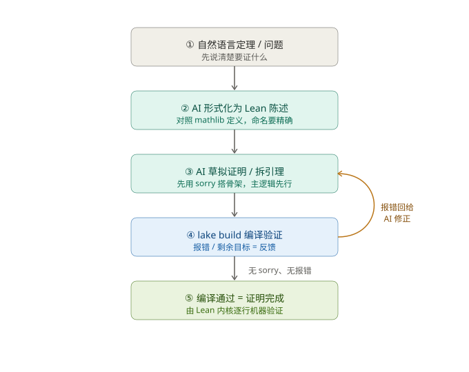

**图 1**　AI 与 Lean 4 交替验证的工作流：AI 负责形式化陈述与草拟证明，Lean 编译器负责裁决正确性，报错与剩余证明目标构成回授给 AI 的精确反馈信号。

### 2.2 核心交互机制：编译器即裁判

该闭环有效的根本原因在于 **Lean 编译器承担了客观裁判的角色**：

1. **反馈的精确性**。编译失败时，Lean 输出的不是模糊的"错误"，而是结构化的诊断信息：具体报错位置、类型不匹配细节、以及最关键的**剩余证明目标（goal state）**，即"当前还差哪一步、手头有哪些假设"。这些信息是形式化的，可以直接作为下一次模型调用的上下文。
2. **幻觉的结构性阻断**。LLM 生成的自然语言证明可能存在看似流畅实则断裂的推理；而在 Lean 中，任何未被内核接受的证明步骤都会导致编译失败，**正确性由编译结果唯一决定**，而非由文本的说服力决定。
3. **陈述先行的形式化契约**。定理陈述（theorem statement）一旦通过编译，即成为一个不可动摇的规范（spec）：后续所有证明尝试都在验证"是否恰好证出了这个命题"，避免偷换论题。

### 2.3 关键技巧：sorry 骨架法

处理复杂定理时，社区普遍采用 **Draft–Sketch–Prove** 式的三段策略：

1. **Draft（草拟）**：先让 AI 用自然语言写出完整证明思路；
2. **Sketch（骨架）**：将思路翻译为 Lean 骨架：主定理与各引理的陈述均通过编译，但证明体用 `sorry` 占位（`sorry` 是 Lean 中表示"此处承认未证"的合法占位符，编译时产生警告而非错误）；
3. **Prove（填坑）**：主逻辑在 sorry 存在的情况下先行验证，确认证明结构无环、无缺口后，再逐个将 sorry 替换为真实证明。每消灭一个 sorry，编译警告减少一条，进度完全可度量。

这一方法将"证明一个大定理"分解为一系列独立、可并行、可回滚的子任务，是 Aristotle 系统与人类协作项目共同采用的核心工程手段。（`sorry` 的语法级用法见下篇第 11.7 节。）

把闭环真正跑起来还有三个工程要点，第四部分会完整展开，这里先立住概念：

1. **快速反馈接口**。每次修改后不必全项目 `lake build`，用 `lake env lean 文件路径` 只检查单个文件，秒级返回全部报错与目标状态，是循环中最常用的命令。
2. **反馈的三类信息**。报错（error，必须处理）、警告（warning，如未消尽的 sorry）、目标状态（Infoview 里"还剩什么要证"）。三者都是形式化文本，可直接回喂给 AI。
3. **失败升级路径**。同一目标反复失败时，按"换 tactic → 补中间引理 → 拆小目标 → 重新审视陈述"的顺序升级，而不是无脑重试。

### 2.4 最小可行示例

以下为在本地 Lean 4 项目（`lake build` 环境下）实际验证的一个定理，展示了该工作流的典型产物：

```lean
/-- 前 n 个正整数之和 -/
def sumTo : Nat → Nat
  | 0 => 0
  | n + 1 => sumTo n + (n + 1)

/-- 高斯求和公式：2·(1+2+…+n) = n(n+1) -/
theorem sum_formula (n : Nat) : 2 * sumTo n = n * (n + 1) := by
  induction n with
  | zero => rfl
  | succ k ih =>
    simp only [sumTo]
    have h : (k + 1) * (k + 1 + 1) = k * (k + 1) + 2 * (k + 1) := by
      rw [Nat.mul_add (k + 1) k 2, Nat.mul_comm (k + 1) k, Nat.mul_comm (k + 1) 2]
    rw [h]
    omega   -- 线性部分由 omega 自动收尾
```

`sum_formula` 体现了典型分工：**AI（或人类）提供归纳证明的结构性思路，Lean 的自动化战术处理机械的代数变形**。它还暴露了一个重要边界：归纳完成后剩余的目标里出现了 `k` 与 `k+1` 的乘积，这是非线性算术，`omega` 只懂线性关系，必须先用分配律与交换律把乘积改写成与归纳假设同型的项（`have h : ...` 那三行），才能交给 `omega` 收尾。这类"最后一步非线性"在证明中极为常见，是初学者最常见的卡点之一。上例中出现的 `def`、模式匹配、`induction`、`simp` 等，下篇第 11、12 章会逐一拆解；本例已通过 `lake env lean` 逐行验证可编译。

## 第 3 章　前沿团队的三种范式

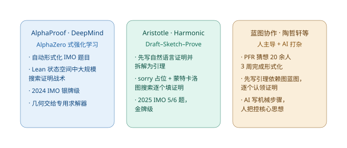

**图 2**　三种代表性范式：AlphaProof 的强化学习搜索、Aristotle 的 Draft–Sketch–Prove 流水线、陶哲轩的人机蓝图协作。

| 范式 | 团队 | 技术路线 | 代表成果 |
|------|------|----------|----------|
| 强化学习搜索 | DeepMind AlphaProof | 将 Lean 证明状态视为博弈状态空间，用 AlphaZero 式 RL + 大规模蒙特卡洛搜索自动生成证明；几何题交给专用求解器 AlphaGeometry 2 | 2024 年 IMO 达银牌水平（28/42 分） |
| 非形式与形式混合 | Harmonic Aristotle | 大模型先写自然语言证明并拆为引理，`sorry` 占位形式化后由蒙特卡洛图搜索（MCGS）填证明，编译报错回流修正 | 2025 年 IMO 解出 5/6 题、金牌水平；发现陶哲轩《Analysis I》教材 4 处习题错误 |
| 人机蓝图协作 | 陶哲轩、Gowers 等 | 数学家先撰写"引理依赖图"蓝图，协作者与 AI 并行认领引理；AI 承担机械性步骤，人把控核心数学思想 | PFR 猜想形式化：20 余人 3 周完成；4,694 个 magma 方程的分类 |

三种范式的共同点值得强调：**最终正确性均由 Lean 内核机器验证，AI 仅承担草拟、搜索与机械执行**。差异在于"搜索的自动化程度"：AlphaProof 全自动搜索，Aristotle 以自然语言推理引导搜索，蓝图协作则由人类主导分解。

对个人研究者而言，这三种范式并非遥不可及：Aristotle 的 Draft–Sketch–Prove 可以压缩成"一句话命题进、编译通过证明出"的个人流水线（第四部分实现），蓝图协作的引理依赖图则适用于论文中整节内容的分工形式化。规模不同，骨架相同。

## 第 4 章　将论文中的统计学定理形式化的操作路径

假设论文中有一条统计学定理（例如："在独立同分布假设下，样本均值是总体均值的无偏估计"），形式化验证的推荐路径如下：

### 4.1 第一步：陈述形式化（最关键也最易出错）

- 将自然语言陈述翻译为 Lean + mathlib 语法。统计学陈述涉及的核心概念在 mathlib 中已有成熟载体：概率空间（`MeasureTheory.ProbabilitySpace`）、随机变量、期望（`∫⁻ x, f x ∂μ` 式的测度积分）、条件期望、独立性与各类收敛（几乎必然 / 依概率 / 依分布）。
- **此步骤应单独编译验证**：先只写陈述、不写证明，与 AI 反复确认定义选取是否与论文中的假设严格对应（例如"可积性"对应 `Integrable` 还是 `IntegrableOn`，矩条件对应哪种类型的可积函数空间）。陈述译错，则后续证明再完美也证错了命题。

### 4.2 第二步：搭建 sorry 骨架

将论文证明的自然语言结构逐句映射为引理链，先用 `sorry` 占位并整体编译。这一步往往能**暴露论文证明中的隐含假设与逻辑跳步**，这是形式化对数学研究本身的独特价值。

### 4.3 第三步：逐引理填坑

- 优先检索 mathlib 已有结果（如 Borel–Cantelli 引理、鞅收敛定理、控制收敛定理、大数定律相关结论），避免重复造轮子；mathlib 的测度论与概率论基础（积分、期望、条件期望、独立性）已相当完备，越靠近经典极限定理覆盖越好，越靠近现代统计推断（回归诊断、渐近有效性、贝叶斯计算）覆盖越薄。
- 机械性步骤交给自动化战术（`simp` / `omega` / `ring` / `aesop`），结构性步骤由 AI 草拟、人工审核后逐条编译。
- 遇到"AI 反复失败"的引理，通常是陈述不够初等，应继续向下拆分。

### 4.4 工程环境

在现有 `lake` 项目中引入 mathlib 依赖（`lakefile.toml` 中添加 mathlib 依赖并由 `lake exe cache get` 获取预编译缓存），配合 VS Code 的 Lean 4 扩展可在编辑器内实时查看证明目标状态；Lean Copilot 等编辑器内 LLM 插件可提供逐战术建议，是当前 mathlib 社区的主流辅助方式。第三部分第 16 章将把这套环境从零搭建起来。

### 4.5 什么样的统计定理适合作为起点

并非所有论文定理都值得第一个形式化。按实战经验，理想的"第一个目标"有四个特征：

1. **自包含**：只依赖测度论与积分的基础 API，不需要自定义复杂结构；
2. **陈述精确**：论文里已有量化表述（"对所有可积函数""对任意 ε>0"），而不是"通常""一般认为"；
3. **有限组合优先**：涉及有限求和、期望线性性的命题（如无偏性）比涉及极限、渐近的命题（如相合性、渐近正态）成本低一个数量级；
4. **反例可检验**：若命题为假，形式化系统能较快给出反证路径，避免在错误命题上空耗。

典型难度阶梯：期望线性性 → 齐次性与平移 → 样本均值无偏性 → 马尔可夫/切比雪夫型不等式 → 大数定律 → 中心极限定理。前三档是第 18 章的实际内容，第四档 mathlib 已有现成引理可调用，后两档属于 mathlib 级别的工程。

## 第 5 章　只给问题、未知答案时，Lean 4 能否独立推导出结果？

这是对"AI 能否自主做数学"的关键拷问。答案需要分层表述：

### 5.1 Lean 本身：验证器，而非发现引擎

Lean 的内核只做一件事：**检查给定证明是否成立**。它不具备"从问题出发寻找证明"的原生能力。其自动化战术（`omega` 线性算术、`ring` 环论恒等式、`aesop` 启发式搜索等）只能在**限定领域内**自动闭合证明；超出该范围，证明的"创造性跳步"必须由外部提供。"限定领域"不是抽象话：第 2.4 节的高斯求和公式就是实例，归纳后剩余目标含 `k` 与 `k+1` 的乘积，`omega` 当场拒绝，必须人工（或 AI）先做非线性改写。这类边界在复杂统计命题中会频繁出现。

### 5.2 AI 驱动的搜索系统：可以，但代价与成功率受限

以 AlphaProof、Aristotle 为代表的系统证明了**在无人类答案的前提下自主找到证明是可能的**（它们在 IMO 上搜索出了此前未见过题目的完整证明）。但其局限同样明确：

- **计算成本巨大**：金牌级表现依赖海量算力与每题分钟到小时级的搜索预算；
- **成功率随问题深度骤降**：Aristotle 2025 年 IMO 唯一未解出的正是最难的第 6 题；研究级开放问题（而非竞赛题）目前仍全面超出自主搜索的能力；
- **陈述形式化仍常需人工介入**：Aristotle 团队明确指出，从英文题目到精确 Lean 陈述的翻译目前仍需要人的参与。

### 5.3 一个容易被低估的能力：辅助证伪

在答案未知时，形式化系统并非只能"证明"。Aristotle 在搜索中引入**目标的逻辑否定**，若命题为假，搜索可以转而构造反例。对于统计定理，这意味着：在投入大量精力证明之前，可先用形式化系统对命题做一遍"可证性/可证伪性"压力测试。

### 5.4 根本性局限

1. **不可判定性**：一阶逻辑的定理寻找问题不可判定，任何搜索系统都存在原则上无法逾越的问题；
2. **形式化缺口（specification gap）**：若陈述翻译与原意有偏差，系统会"完美地证错东西"，正确性保证只覆盖被形式化的那个陈述；
3. **库覆盖缺口**：命题依赖的背景理论若尚未进入 mathlib，形式化的前置成本可能远超证明本身；
4. **数值与渐近论证的代价**：统计学中大量依赖的渐近分析、逼近论与数值论证，在类型论中形式化代价显著偏高。

## 第 6 章　Lean 4 的定位：数学工具而非统计学工具

Lean 4 + mathlib 的本质是**通用数学基础的形式化系统**：它验证的是"从公理出发的演绎推理链条"，其天然主场是代数、分析、数论等结构数学领域。而统计学的核心关切与此存在系统性的错位：

| 维度 | 演绎数学（Lean 的主场） | 统计学（Lean 的弱项） |
|------|--------------------------|------------------------|
| 结论性质 | 定理：在假设下必然成立 | 推断：在不确定性下给出置信陈述 |
| 正确性标准 | 逻辑有效性（可机器判定） | 方法论的恰当性 + 数据的支撑（多为经验判断） |
| 核心活动 | 证明 | 建模、估计、检验、模拟 |
| 对"验证"的需求 | 证明无缺口 | 结果可复现、计算无误、推断不误导 |

换言之，统计学家日常的"验证"需求（这个模拟对不对？这个 p 值算对了吗？这段代码可复现吗？）大部分**不是演绎证明问题**，Lean 并非为此设计。但这不意味着 Lean 与统计无关，恰好相反，统计学中所有**数学定理层面的内容**（大数定律、中心极限定理、Cramér–Rao 下界、收敛性与渐近性质）都是演绎命题，理论上均可形式化。错位的只是"定位"：**Lean 适合验证统计学的数学骨架，不适合验证数据分析流程本身**。

## 第 7 章　统计学界的形式化与验证工具生态

统计学界确实发展了多种验证工具，但它们与 Lean 属于**不同的验证层次**：

### 7.1 通用证明助手中的概率与统计内容

| 工具 | 统计/概率相关能力 | 特点 |
|------|-------------------|------|
| **Lean 4 + mathlib** | 测度论、概率分布、条件期望、鞅、大数定律等经典极限定理 | 数学基础最现代，社区增长最快 |
| **Isabelle/HOL** | HOL-Probability 概率理论库；Archive of Formal Proofs 收录随机算法分析、期望正确性等形式化 | 自动化程度高，理论计算机界使用广泛 |
| **Rocq（原 Coq）** | Infotheo（信息论形式化）、Flocq（浮点运算形式化）、Coquelicot（实分析） | 验证数值算法与浮点实现的标杆 |
| **Agda** | 依值类型下的概率语义研究 | 研究性使用为主 |

### 7.2 统计报告与计算的专门验证工具

- **statcheck**：自动重算论文中 NHST 报告的 p 值，检查统计量、自由度与 p 值之间的一致性，已用于大规模审计心理学期刊文献；
- **GRIM / SPRITE 检验**：检查报告的均值、样本量在粒度上是否可能一致（如"3.36 的均值不可能来自 12 个 0/1 数据点"），是发现数据异常的轻量形式检查；
- **统计模型检测（Statistical Model Checking，如 PRISM、UPPAAL SMC）**：对难以解析求解的随机系统，用大规模模拟 + 序贯假设检验来"验证"性质满足概率界，这是统计学思想反哺形式验证的例子；
- **可验证概率程序与数值计算**：F* / Flocq 一系的浮点验证、概率编程语言的验证语义研究（如 Dice、Aqua 等学术系统），目标是给蒙特卡洛类计算以机器检查的保证；
- **统计软件工程验证（R Validation Hub、testthat 等）**：药物监管与行业场景下的 R 包验证框架，提供的是回归测试与文档化的工程保证，而非数学证明。

### 7.3 对比小结

上述工具构成一个**保证强度递减、贴近统计实践递增**的光谱：

```
Lean/Isabelle/Rocq（数学定理级，最强保证）
    → statcheck/GRIM（报告一致性，局部检查）
        → 统计模型检测（概率界保证，依赖模拟）
            → R 验证生态（可复现性，工程保证）
```

对论文工作的启示是：**定理部分**（数学命题）用 Lean 形式化可提供最强保证；**计算与报告部分**则应选择 statcheck 类审计工具与可复现计算实践，二者互补而非替代。落地顺序上建议先轻后重：statcheck 与 GRIM 检验是分钟级的脚本检查，可以在投稿前对全文先跑一遍；Lean 形式化是小时到天级的工程，只投给核心定理。

## 第 8 章　上篇小结与实践建议

1. **机制上**，AI + Lean 4 的有效性来自"生成-验证"闭环：AI 生成候选，编译器以精确的形式化反馈回授，幻觉被结构性阻断。
2. **方法上**，陈述形式化是第一位的难点，`sorry` 骨架法是管理复杂度的核心工程手段。
3. **能力边界上**，在答案未知时，Lean 本身不发现证明，但 AlphaProof/Aristotle 类系统已能在高代价下自主证明竞赛级命题，并可辅助证伪；研究级开放问题仍需人类主导。
4. **定位上**，Lean 验证的是统计学的"数学骨架"而非数据分析流程；论文的定理部分可形式化，实证与计算部分应辅以 statcheck、统计模型检测与可复现工程实践。
5. **行动建议**：从论文中一条自包含、依赖 mathlib 已有理论的定理入手（如某估计量的相合性或无偏性），按第 4 章路径完整走一遍"陈述 → sorry 骨架 → 填坑"流程，以最小成本验证该范式对本课题的适配度。

> **过渡到下篇**：以上完成了"为什么"与"是什么"的论述，但一切机制最终都落在"你亲手写下的一行行 Lean 代码"上。下篇以零基础视角从安装环境开始，把上篇出现的每个概念（def、tactic、Infoview、sorry、归纳证明）逐一落到手上，学完即可独立看懂并跟做 AI + Lean 的完整工作流。

---

# 下篇｜零基础实操入门

> **本篇假设**：你只会 Python，没听说过 Lean，用的是 Windows。

## 第 9 章　在 Windows 上安装 Lean 4

### 9.1 安装前须知（30 秒，避免后面所有坑）

1. **项目路径必须纯英文、无空格**。不要放在含中文的目录（如 `I:\我的桌面\`）！推荐统一放在 `D:\lean\`（没有就先建：资源管理器 → D 盘右键新建文件夹，命名 `lean`）。中文路径是 Lean 在 Windows 上最常见的翻车原因。
2. 安装器需要联网下载约 300 MB（后续项目按需更多）。如果你的网络访问 GitHub 不稳定，**先开好系统代理**再进行。
3. 全程**不需要管理员权限**。

### 9.2 安装 Lean 工具链（elan）

Lean 本体由一个叫 **elan** 的"版本管理器"负责安装和维护（类比：nvm 之于 Node.js、pyenv 之于 Python）。

**方法 A（推荐，图形界面）**：
1. 浏览器打开 https://github.com/leanprover/elan/releases
2. 找到最新版本，下载其中的 **`elan-init.exe`**（Windows 图形安装器）。
3. 双击运行，一路默认（它会安装到 `%USERPROFILE%\.elan\` 并自动添加 PATH）。
4. 完成后窗口会显示 "stable toolchain installed" 之类信息。

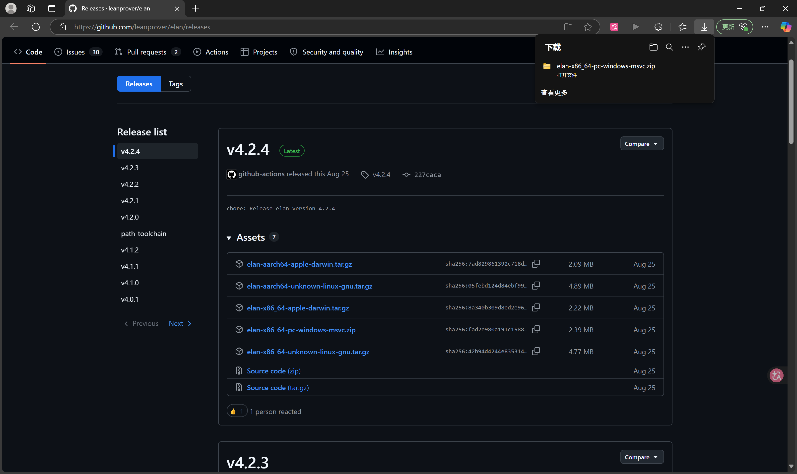

**方法 B（PowerShell 命令行，与方法 A 二选一）**：
按 `Win` 键 → 输入 `powershell` → 打开 Windows PowerShell，逐行执行：

```powershell
Invoke-WebRequest -Uri "https://raw.githubusercontent.com/leanprover/elan/master/elan-init.ps1" -OutFile "$env:TEMP\elan-init.ps1"
powershell -ExecutionPolicy Bypass -File "$env:TEMP\elan-init.ps1" -y --default-toolchain stable
```

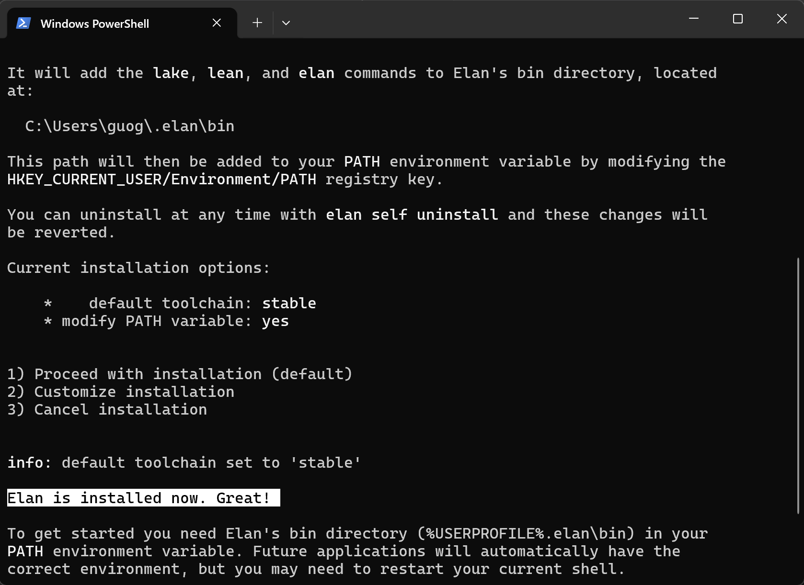

### 9.3 验证安装

**关闭当前所有终端窗口，重新开一个**（PATH 环境变量只对新开的终端生效，这是 Windows 的规矩），然后：

```powershell
lean --version
lake --version
elan show
```

预期看到类似输出：

```
Lean (version 4.x.x, ...)
Lake version x.x.x
```

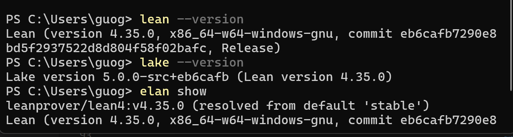

> ❗ 如果提示 `'lean' 不是内部或外部命令`：见 9.6 错误表 E1。

### 9.4 安装 VS Code 与 Lean 4 插件

1. 已有 VS Code 可跳过；没有就去 https://code.visualstudio.com 下载安装（安装时勾选"添加到 PATH"）。
2. 打开 VS Code → 左侧"扩展"图标（四个方块）→ 搜索框输入 **lean4** → 找到作者为 **leanprover** 的 "lean4" 扩展 → 点 **Install**。


3. （可选但推荐）再装一个 **Chinese (Simplified) 语言包**，界面变中文。

### 9.5 安装后自检清单

- [x] 新终端里 `lean --version` 有输出
- [x] VS Code 已装 lean4 扩展
- [x] `D:\lean\` 文件夹已建好

四项全过 → 进入第 10 章。

### 9.6 常见安装错误速查表

| 编号 | 症状 | 原因 | 解决 |
|---|---|---|---|
| E1 | `'lean' 不是内部或外部命令` | PATH 未生效或安装未完成 | ① 关掉所有终端重开；② 确认 `%USERPROFILE%\.elan\bin` 文件夹存在且里面有 `lean.exe`；③ 重启电脑（PATH 刷新最彻底的办法） |
| E2 | PowerShell 提示"在此系统上禁止运行脚本" | 执行策略限制 | 方法 B 的命令里已带 `-ExecutionPolicy Bypass`；若手动运行 .ps1 报此错，在命令前加上 `powershell -ExecutionPolicy Bypass -File` |
| E3 | elan 下载工具链时卡住/失败，或 `lean --version` 首次运行时自动开始下载且速度极慢（如 22 KiB/s） | 访问 GitHub/releases.lean-lang.org 不稳定。**注意：首次运行 `lean --version` 触发自动下载是正常行为**（只装了 elan 管理器、编译器本体按需下载，`could not canonicalize path ... toolchains` 的 warning 也属正常），只需解决速度问题 | ① Ctrl+C 停掉（不支持续传，重下即可）；② 开系统代理后查询端口：`Get-ItemProperty 'HKCU:\Software\Microsoft\Windows\CurrentVersion\Internet Settings' \| Select-Object ProxyEnable, ProxyServer`；③ **同一个** PowerShell 窗口里执行 `$env:HTTP_PROXY="http://127.0.0.1:端口"; $env:HTTPS_PROXY="http://127.0.0.1:端口"`；④ 重跑 `elan toolchain install stable`；⑤ `elan show` 确认列出 stable。**注意区分两套代理**：终端环境变量 `$env:HTTP_PROXY`（可能指向一个早已失效的端口，报 `CONNECT tunnel failed, response 502`）与系统代理（设置里查到的 `ProxyServer` 端口）。环境变量优先级更高，务必用系统代理的真实端口覆盖它，并在**同一个**终端里执行后续命令。实测中"小请求能通、大传输 502"是代理不稳定的典型表现，重试或改浅层操作可绕过。无代理时备选：VPN 切全局/TUN 模式、换手机热点。以后 Mathlib 的 `lake exe cache get`（约 2 GB）同样先设这两个变量 |
| E4 | VS Code 里打开 .lean 文件，右下角一直转圈或报 "server failed to start" | 插件没找到 Lean | 先确认 9.3 通过；然后 `Ctrl+Shift+P` → 输入 `Lean: Restart Server` 回车；仍失败就重启 VS Code |
| E5 | 项目建在中文/空格路径，编译报各种奇怪错误 | Lean 工具链对路径敏感 | 把项目挪到纯英文路径，重新打开 |
| E6 | 杀毒软件报警或编译奇慢 | 实时扫描 `.elan` 目录 | Windows 安全中心 → 排除项 → 添加 `%USERPROFILE%\.elan`（可选操作） |


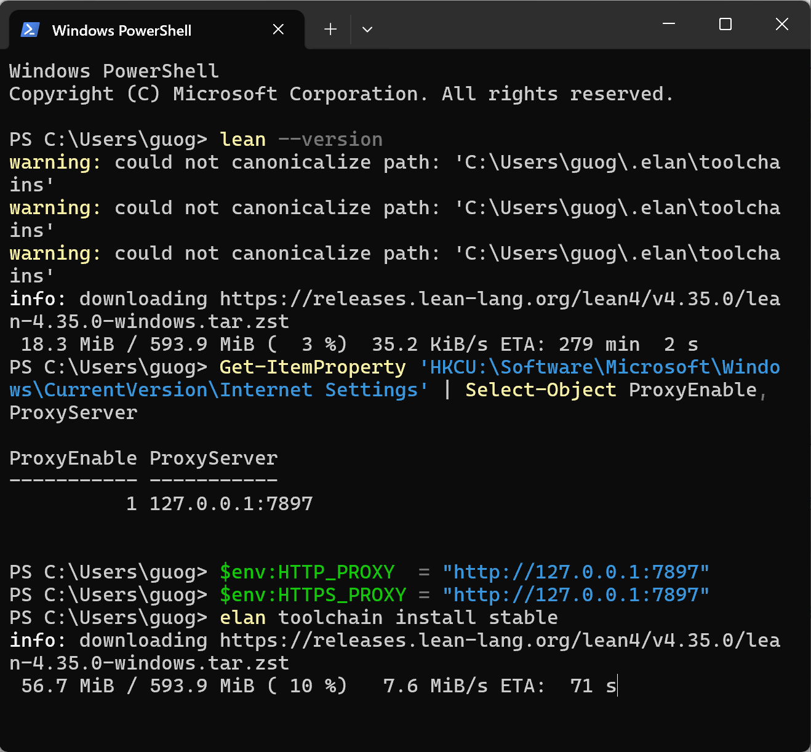

## 第 10 章　第一个项目：lake init 与 Infoview

先提前安装 git：在 PowerShell 中执行 `winget install --id Git.Git -e`

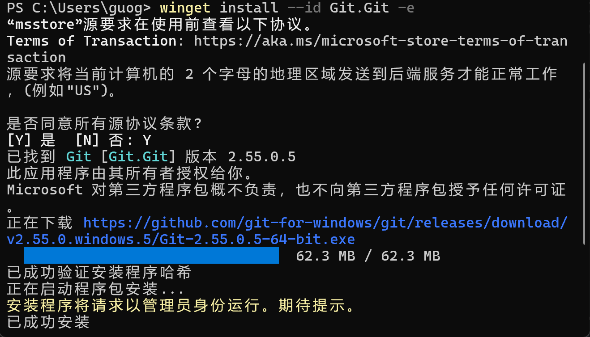

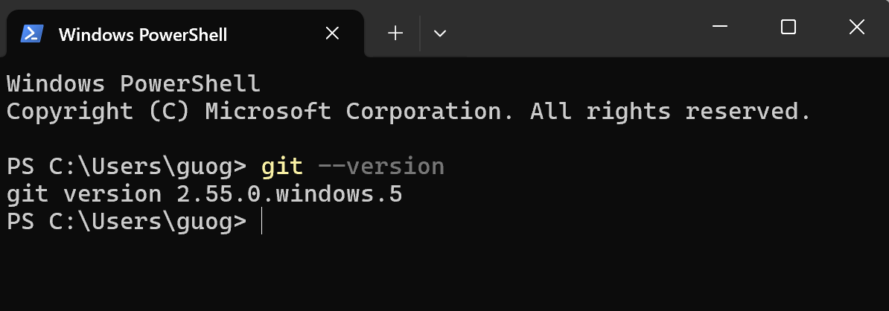

### 10.1 背景知识：lake 是什么

**lake** 是 Lean 的项目管理器（类比 Python 的 pip + venv 合体）：负责建项目、编译、跑程序、管理依赖。Lean 项目的标准动作就三个：

```
lake init 项目名   →  在当前目录初始化项目（只做一次）
lake build        →  编译（相当于"检查+构建"）
lake exe 项目名    →  运行可执行程序
```

> ⚠️ **易踩的坑**：与 cargo 等工具不同，**`lake init hello` 不会创建名为 `hello` 的子目录**，而是把项目直接初始化在**当前目录**里（"hello" 只是包名）。想在子目录里建新项目应使用 `lake new hello`（它会创建子目录并自动 init）。实际操作中曾有人 `cd` 进包内自动生成的库目录 `Hello\` 后执行 `lake build`，因该目录里没有 lakefile 而报 `no configuration file with a supported extension` 错，报错路径里的 `D:\lean\Hello\lakefile.lean` 正是这个原因（Windows 大小写不敏感，`cd hello` 会匹配到 `Hello`）。**始终在项目根目录（有 lakefile 的那层）执行 lake 命令。**

### 10.2 动手：三分钟建好第一个项目

打开**命令提示符**（`Win` 键 → 输入 `cmd`），逐行执行：

```cmd
D:
cd D:\lean
lake init hello
lake build
```

预期过程：`lake init` 会在 `D:\lean` 当前目录生成若干文件并自动下载/编译基础组件（**第一次约 3 分钟，耐心等**）；`lake build` 最后应显示 `Build completed successfully.`

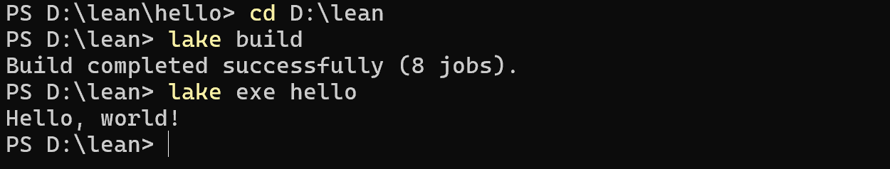

生成的项目结构（知道有这些文件即可，先不用管是什么意思）：

```
D:\lean
├── lakefile.toml      ← 项目配置在这里！
├── lean-toolchain     ← 记录本项目用哪个 Lean 版本
├── Hello.lean / Main.lean / README.md  ← Main.lean主程序文件（我们重点用它）
└── Hello\             ← 这是库源码目录（包名 hello 的模块根目录，首字母自动大写）
    └── Basic.lean
```

### 10.3 用 VS Code 打开项目，认识 Infoview

1. VS Code → 文件 → 打开文件夹 → 选 `D:\lean`
2. 打开 `Main.lean`。第一次打开时右下角会提示导入/构建，**点允许/等待**，直到状态栏左下角 Lean 图标停止转圈。
3. **关键一步**：把光标放在文件里任意一行代码上，看 VS Code **右侧**，出现了 Infoview 面板（可能显示 "No goals" 之类的字样）。如果没显示：`Ctrl+Shift+P` → 输入 `Lean: Toggle Infoview` 回车。

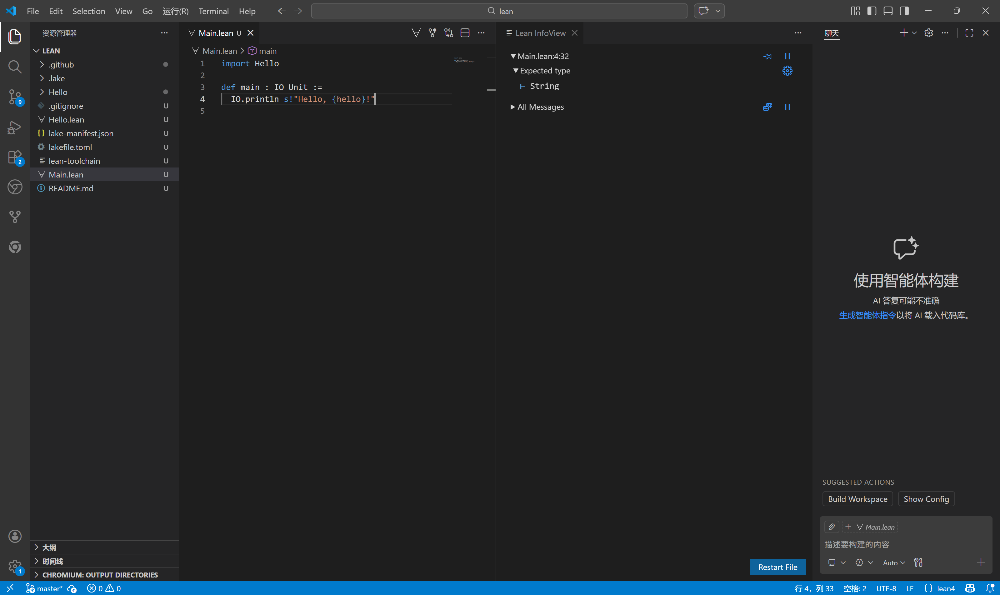

4. 模板的 `Main.lean` 自带一句 Hello（不同版本可能是 `#eval "Hello, world!"` 或 `IO.println`）。**把光标移到那一行末尾**，如果 Infoview 或该行下方显示出字符串内容，恭喜：你的 Lean 环境完全打通了。

### 10.4 运行它

在终端（VS Code 里 `Ctrl+~` 打开）执行：

```cmd
lake exe hello
```

预期输出 `Hello, world!`（或模板对应内容）。

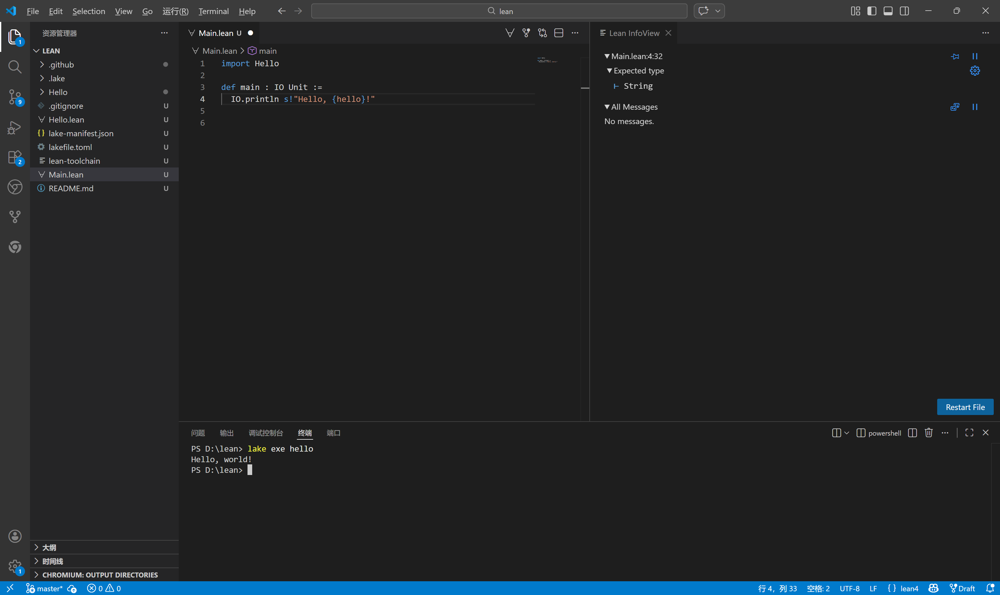

> **两种"运行"要分清**：
> - `lake exe hello` = 把程序**跑起来**看输出（像 `python main.py`）；
> - 编辑器里的实时检查 = **逐行验证**正确性（Python 没有的能力，Lean 的灵魂，即上篇第 1 章所说的内核检查）。

### 10.5 本章练习

在 `Main.lean` 末尾加两行，保存，把光标放到第一行行尾，观察输出：

```lean
#eval 1 + 2 * 3
#check 1 + 2 * 3
```

你会看到：`#eval` 显示 `7`（算出来），`#check` 显示 `7 : Nat`（告诉你类型）。**`#eval` 问"值是多少"，`#check` 问"这是什么类型"，这对命令将伴随你整个 Lean 生涯。**

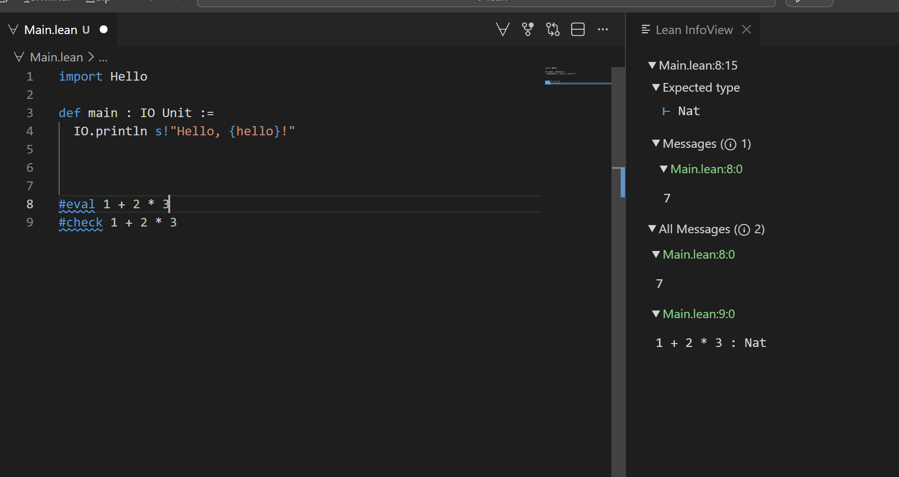

## 第 11 章　基础语法（Python 对照版）

> 本章所有代码都直接粘进 `Main.lean` 保存即可，光标停到对应行就能在 Infoview 看结果。建议**每小节都亲手敲一遍**。
> 每段代码顶部有 `--` 开头的行，那是 Lean 的注释（同 Python 的 `#`）。

### 11.1 一切皆类型：`def` 与类型标注

```lean
-- Python:  x = 42
def x := 42

-- Python:  x: int = 42   （Python 3 的类型标注只是"建议"）
def y : Nat := 42         -- Lean 的标注是"合同"，写错了直接报错

#eval y          -- 42
#check y         -- y : Nat
#check x         -- x : Nat   （没写类型，Lean 也推断出来了）
```

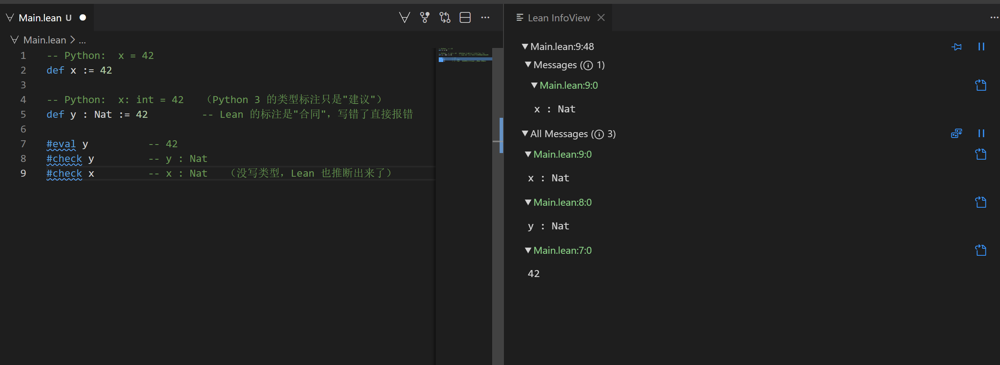

**基础类型速查**（对照 Python）：

| Lean | Python 对应 | 说明 |
|---|---|---|
| `Nat` | 非负 `int` | 数学自然数，任意精度 |
| `Int` | `int`（含负数） | |
| `Float` | `float` | 少用！有舍入误差，数学证明一般避开 |
| `Bool` | `bool` | 只有 `true` / `false`（全小写！） |
| `String` | `str` | |
| `List Nat` | `list[int]` | 列表，元素类型写在尖括号位置 |

> **重要差异**：Python 的 `True/False` 首字母大写，Lean 的 `true/false` 全小写。写错立刻有红线，改过来就行。

### 11.2 函数定义：像 Python，但更严格

```lean
-- Python:  def add(a, b):
--              return a + b
def add (a b : Nat) : Nat := a + b

#eval add 3 5        -- 8
#check add           -- add : Nat → Nat → Nat
```

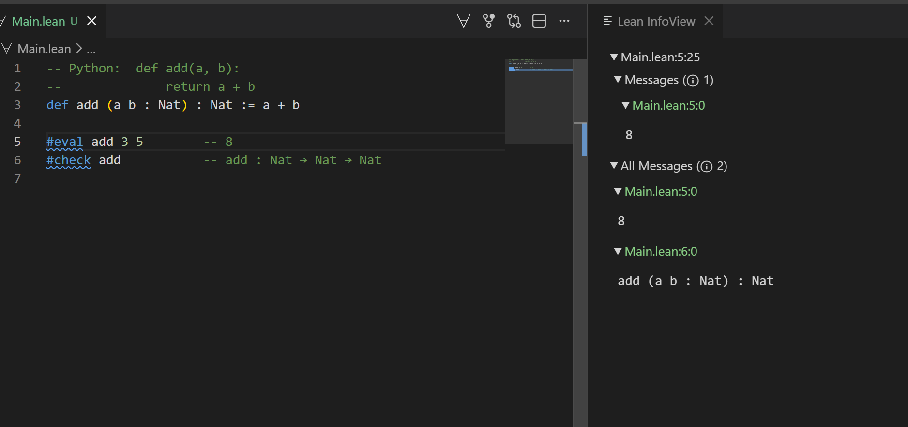

两个注意点：

1. **没有 `return`，没有括号，没有逗号**：`add (a b : Nat) : Nat := a + b` 读作"add 接收两个 Nat，返回 Nat，定义为 a + b"。`:=` 就是 Python 的 `return`/赋值合体。
2. **`Nat → Nat → Nat` 是"柯里化"**：Lean 里所有函数本质上都是**单参数**函数，`add 3` 不报错，而是返回一个"还差一个数的新函数"：

```lean
#check add 3        -- add 3 : Nat → Nat   （吃掉一个参数，还剩一个）
#eval (add 3) 5     -- 8，跟 add 3 5 等价
#eval add 3         -- 报错！#eval 只能算出"最终的值"，函数不是值……
                    -- 严格说函数也是值，但不可打印。理解到"add 3 是个半成品"即可
```

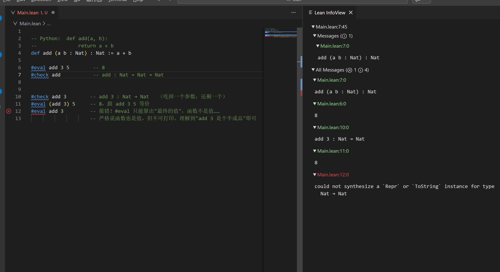

这个"函数可以只喂一半"的特性叫**部分应用**，Python 里要用 `functools.partial`，Lean 里是免费的。

**匿名函数**（类比 Python 的 `lambda`）：

```lean
-- Python:  f = lambda a, b: a * b
def mul : Nat → Nat → Nat := fun a b => a * b
#eval mul 6 7      -- 42
```

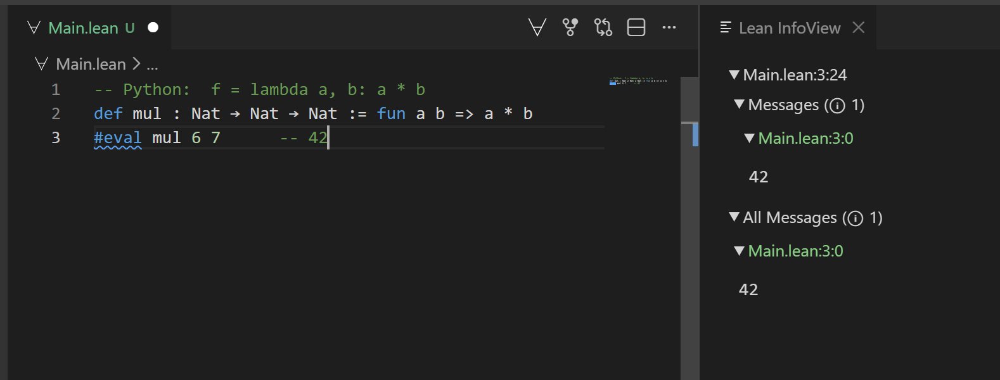

### 11.3 分支：if-then-else，以及 Bool 与 Prop 的天壤之别

```lean
-- Python:  def is_big(n): return n > 100
def isBig (n : Nat) : Bool := n > 100

#eval isBig 250     -- true
#check isBig 250    -- isBig 250 : Bool
```

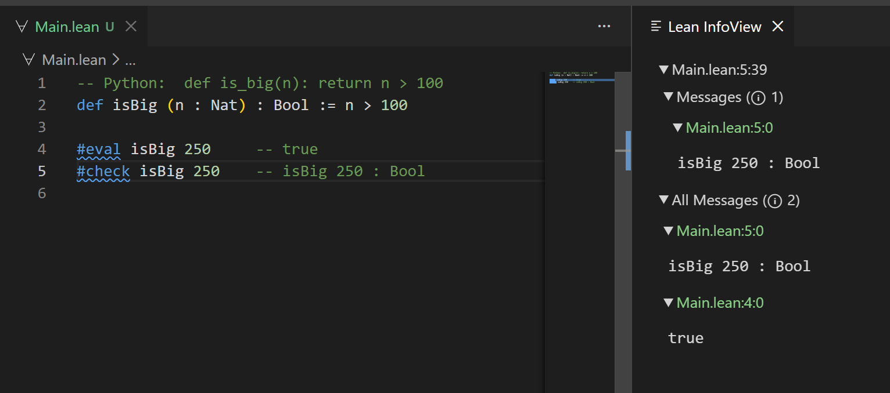

**请注意**：`n > 100` 在 Lean 里既可以是 `Bool`（算出来 true/false），也可以是**命题 Prop**（一个有待证明的数学陈述）。区分它们是初学者最重要的一课。上篇第 1 章"机器验证证明"的主角正是 Prop：证明一个命题 = 给出它的一个证明项：

```lean
#check (fun n : Nat => n > 100)   -- Nat → Prop
#check (fun n : Int => n > 100)   -- Int → Prop
#check (fun x : Rat => x > 100)   -- Rat → Prop


#check (fun n : Nat => decide (n > 100))   -- Nat → Bool   ✅ 这才是 Bool
#check (fun n : Nat => Nat.blt 100 n)      -- Nat → Bool   ✅ 编译器内建版本
```

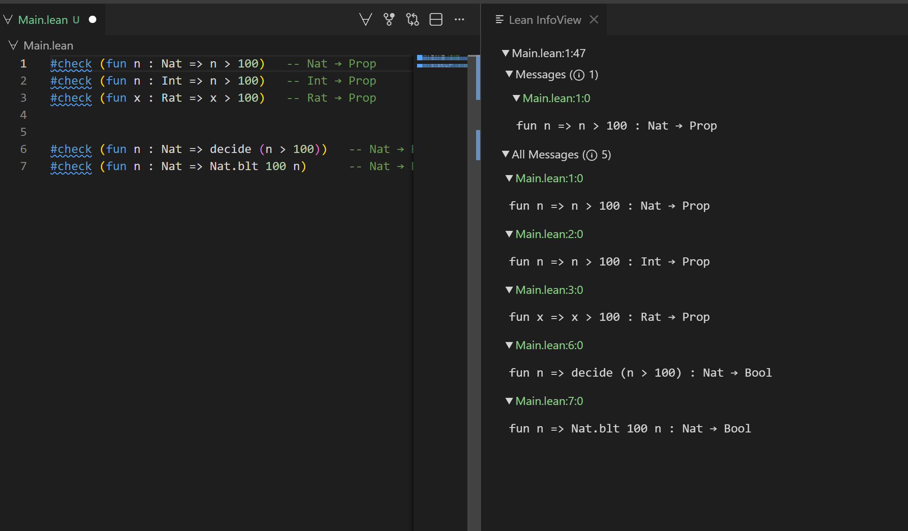

if-then-else 语法：

```lean
def grade (n : Nat) : String :=
  if n >= 90 then "A"
  else if n >= 60 then "B"
  else "C"

#eval grade 95      -- "A"
```

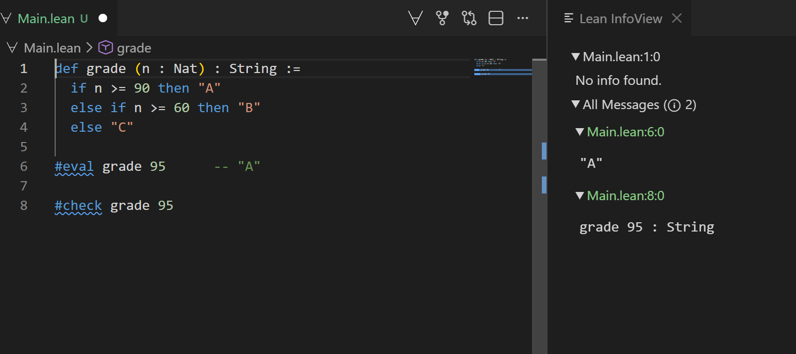

和 Python 几乎一样，只是 `else if` 不能连写成 `elif`，且必须有 `else` 分支（**每个分支类型一致**，否则编译器抓你）。

### 11.4 递归与模式匹配：Lean 的核心写法

Lean 没有循环（没有 `for`/`while`），**递归就是循环**。定义递归函数最漂亮的写法是模式匹配：

```lean
-- Python:  def fact(n):
--              if n == 0: return 1
--              return n * fact(n - 1)
def fact : Nat → Nat
  | 0 => 1                    -- 情况一：n = 0
  | n + 1 => (n + 1) * fact n -- 情况二：n = k+1 时，用 k 的情况
                               -- （写 n+1 而不是 n-1，因为 Nat 没有 -1！）

#eval fact 0     -- 1
#eval fact 10    -- 3628800
#eval fact 50    -- 30414093201713378043612608166064768844377641568960512000000000000
                 -- Python int 也算得出，但 Lean 的 Nat 是数学意义的精确自然数
```

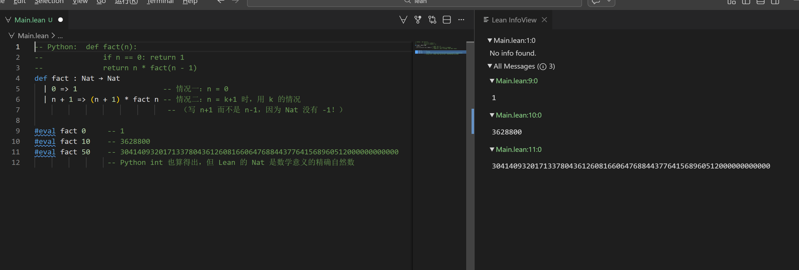

**读懂模式匹配**：`| 0 => 1` 和 `| n + 1 => ...` 合起来覆盖了所有自然数，这其实就是**数学归纳法**的代码形态！基础情形（0）+ 归纳情形（从 n 到 n+1）。Lean 的编译器还会**检查你的递归一定会停**（每一层 n 都在变小），写一个死循环递归它直接拒绝编译，Python 可不会管你。

> 💡 为什么写 `n + 1` 不写 `n - 1`？因为 `Nat` 是自然数，`0 - 1` 在数学上无意义。Lean 用"+1 的模式"表达"前驱"，这是新手最常撞墙的地方，习惯就好。

斐波那契（两种写法）：

```lean
-- 写法一：模式匹配（推荐）
def fib : Nat → Nat
  | 0 => 0
  | 1 => 1
  | n + 2 => fib (n + 1) + fib n
-- 若你的版本对 n+2 模式报错，改成 | (n + 1) + 1 => fib (n + 1) + fib n

-- 写法二：更像 Python 的 if 写法
def fib2 (n : Nat) : Nat :=
  if n <= 1 then n else fib2 (n - 1) + fib2 (n - 2)

#eval fib 10      -- 55
#eval fib 20      -- 6765
#eval fib2 20     -- 6765（两种写法结果一致）
```

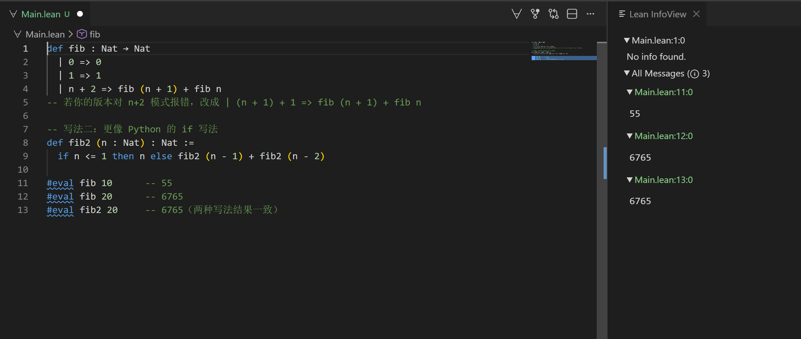

### 11.5 数据结构：列表、Option、元组、structure

**列表**（类比 Python list）：

```lean
def xs : List Nat := [1, 2, 3, 4]
#eval xs          -- [1, 2, 3, 4]
#eval xs.length   -- 4（点语法和 Python 一样）
#eval xs ++ [5, 6]  -- [1, 2, 3, 4, 5, 6]  ++ 就是 Python 的 +
#eval xs.head?    -- some 1   （注意问号！）
#eval [].head?    -- none
```

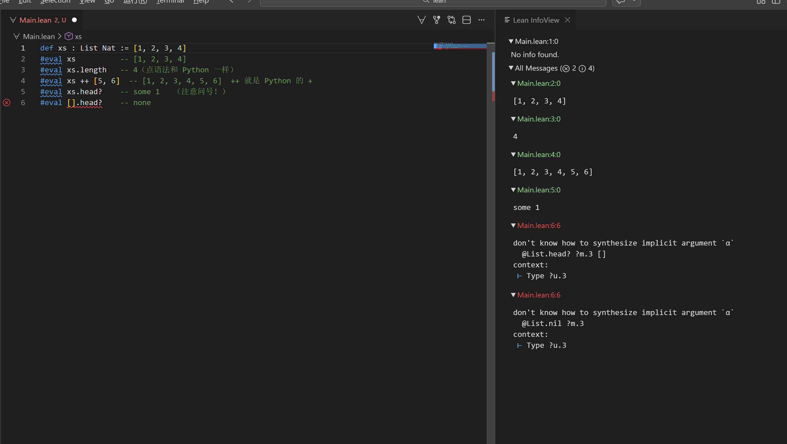

**Option：比 Python 更安全地表达"可能没有"**。Python 里 `list[0]` 对空列表直接抛异常，或返回 `None` 由你祈祷调用者记得判空。Lean 用类型系统强制你处理两种情况：

```lean
def safeHead : List Nat → Option Nat
  | [] => none            -- 空表：显式给 none
  | x :: _ => some x      -- 非空：第一个元素 x，剩下不要（_ 是占位）

#eval safeHead [7, 8]     -- some 7
#eval safeHead []         -- none
```

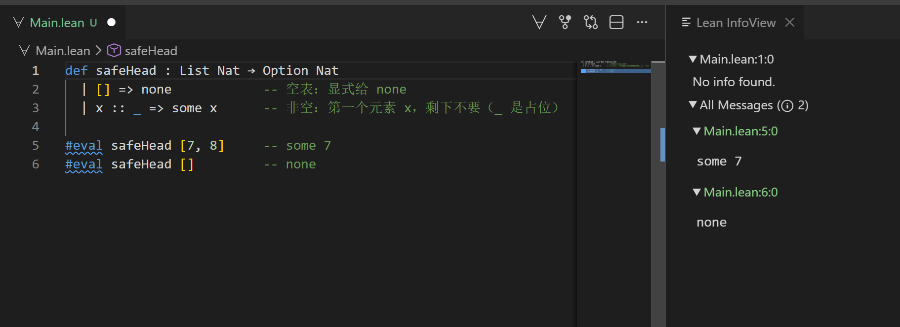

**列表的递归处理**（最重要的范式，后面证明会用到）：

```lean
def mySum : List Nat → Nat
  | [] => 0                 -- 空表之和 = 0
  | x :: xs => x + mySum xs -- 首元素 + 其余之和

def myLen : List Nat → Nat
  | [] => 0
  | _ :: xs => 1 + myLen xs

#eval mySum [1, 2, 3, 4]   -- 10
#eval myLen [1, 2, 3, 4]   -- 4
```

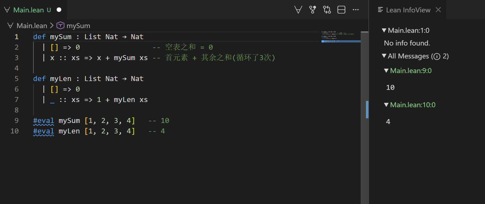

读法：`x :: xs` 表示"列表拆成第一个元素 x 和剩余列表 xs"（`::` 相当于 Python 里 `[x] + xs` 的逆操作，**解构**）。

**元组**：

```lean
def swap (p : Nat × String) : String × Nat := (p.2, p.1)
#eval swap (1, "one")     -- ("one", 1)
-- Nat × String 相当于 Python 的 tuple[int, str]；p.1 p.2 取分量（从 .1 开始数）
```

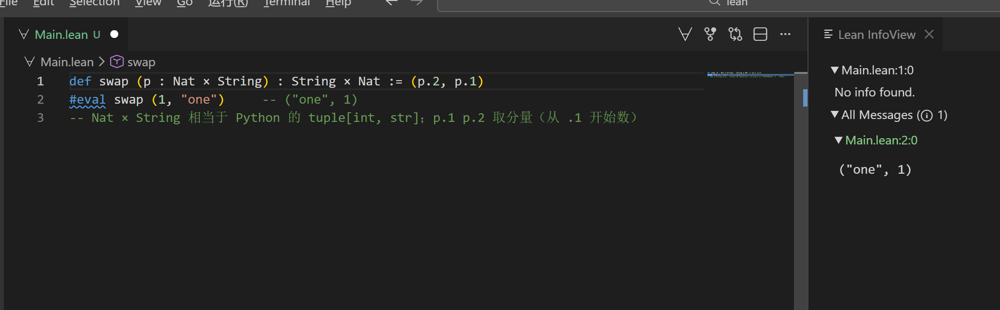

**structure：自定义数据类型**（类比 Python 的 dataclass）：

```lean
structure Point where
  x : Float
  y : Float

def origin : Point := { x := 0.0, y := 0.0 }   -- 用字段名构造
#eval origin.x        -- 0.000000
```

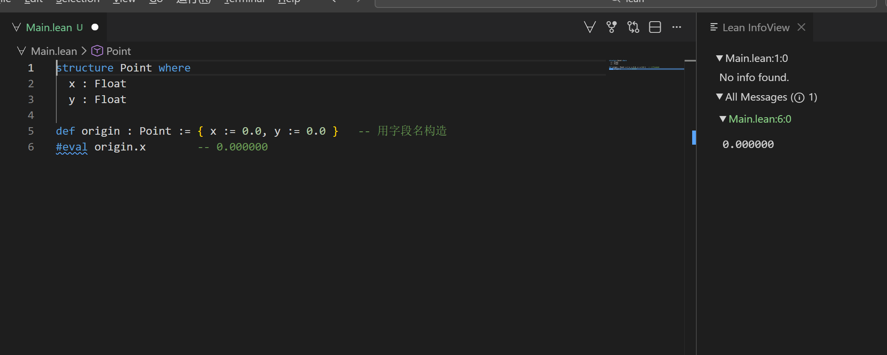

### 11.6 Unicode 输入：Lean 的"拼音输入法"

Lean 大量使用数学符号（`→ ∀ ∧ ℕ`…），但**不需要输入法**，在 VS Code 里打反斜杠开头的缩写即可，再按键盘 `Tab` 键：

| 你敲 | 出现 | 含义 |
|---|---|---|
| `\to` | → | 函数类型箭头 |
| `\nat` | ℕ | 自然数（部分环境可用，直接打 `Nat` 最稳） |
| `\and` | ∧ | 且 |
| `\or` | ∨ | 或 |
| `\not` | ¬ | 非 |
| `\forall` | ∀ | 任意 |
| `\exists` | ∃ | 存在 |
| `\alpha` | α | 任意类型参数 |
| `\iff` | ↔ | 当且仅当 |

```
-- ✅ 正确：类型里用 →，函数体里用 =>
example : Nat → Nat := fun x => x + 1

-- ❌ 错：fun 后面必须是 =>
example : Nat → Nat := fun x → x + 1

-- ✅ => 也用在 match 分支
def f (n : Nat) := match n with | 0 => 1 | _ => n
```

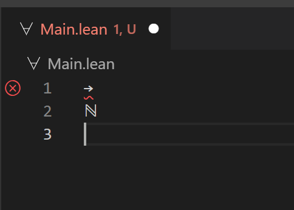

敲完反斜杠序列后按空格或回车确认。打错了删掉重敲即可。

### 11.7 新手必知：`sorry` 与红色错误

```lean
def todo (n : Nat) : Nat := sorry   -- 占位符："这里我还没写完"
```

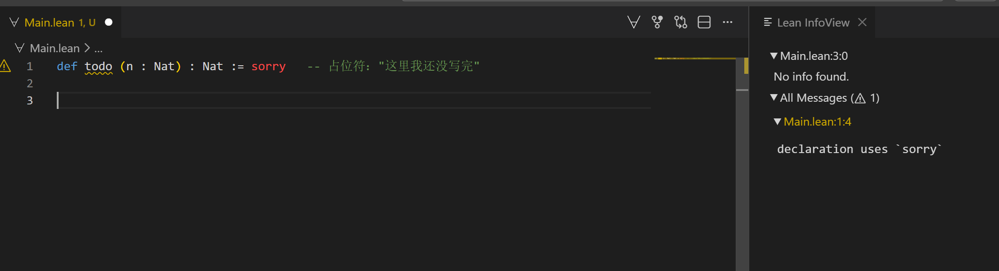

`sorry` 让代码暂时通过编译，但编辑器会一直显示**黄色警告** "declaration uses 'sorry'"，它是 Lean 版的 TODO 标记，**永远不会被忘记**。写证明时先用 `sorry` 占位、再逐步消灭，是标准工作流；上篇第 2.3 节的"sorry 骨架法"正是把这一语法级机制扩展成了管理大型证明的工程方法。

## 第 12 章　定理证明入门：Lean 的灵魂部分

### 12.1 从"计算"到"证明"

前面 `#eval` 都是**计算**。现在开始**证明**。最简单的"证明"是 `rfl`（reflexivity，自反性），**两边本来就是一个东西**：

```lean
example : 2 + 2 = 4 := by rfl
```

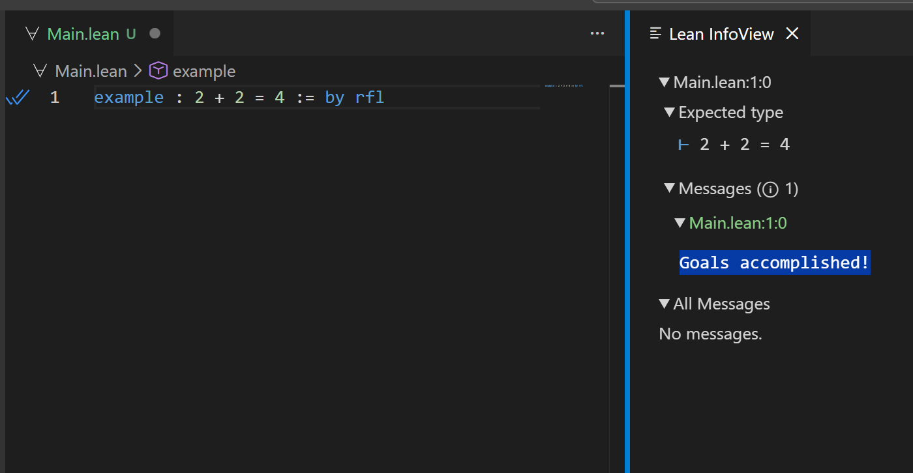

读法："举一个例子命题：2+2=4，用 rfl 证明"。`by rfl` 意思是"用 rfl 这个策略（tactic）来证"。你也可以对任意数来：

```lean
example (n : Nat) : n + 0 = n := by rfl   -- n+0 在定义上就化简为 n
```

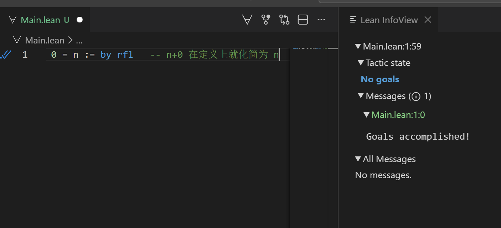

**Prop 世界 vs Bool 世界**：`2 + 2 = 4` 不是"算出 true 的表达式"，而是一个**命题**；`rfl` 是交给阅卷老师的证明。Lean 的每个定理都是这样一行：**陈述 + 证明**，机器当场验收，这正是上篇第 1 章"证明由内核机器检查"的第一手体验。

### 12.2 你的第一个 tactic 工具箱

| tactic | 干什么 | 类比 |
|---|---|---|
| `rfl` | 两边本来相等（定义即相等） | "这还用证？" |
| `decide` | 直接算（命题可计算时） | 暴力枚举 |
| `simp` | 自动化简（调用内置化简规则库） | 智能化简器 |
| `rw [引理名]` | 用已知等式重写目标 | 代入消元 |
| `exact 项` | 直接给出一个现成的证明 | 引用文献 |
| `induction n` | 数学归纳法 | 归纳证明 |
| `omega` | 自动解决线性整数/自然数算术（Lean 自带，无需 mathlib） | 超级计算器 |

> 补充：`ring`（环论恒等式）、`linarith`（线性实数/整数不等式）、`nlinarith`（非线性）等更强的自动化战术来自 mathlib，安装后才能用；`omega`、`simp`、`decide`、`rfl` 则是核心自带。

**动手体会**（逐行粘贴，光标停在各行观察 Infoview 的变化，这是学 tactic 的唯一正道）：

```lean
-- ① decide：可计算的命题直接算
example : 2 ^ 10 = 1024 := by decide
example : 17 % 3 = 2 := by decide

-- ② simp：自动化简
example (n : Nat) : 0 + n = n := by simp

-- ③ rw：用引理重写
example (a b : Nat) : a + b = b + a := by rw [Nat.add_comm]
```

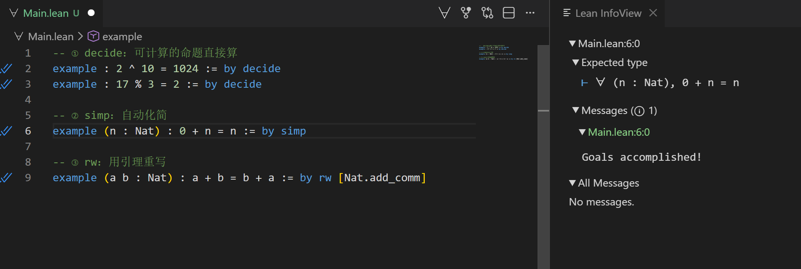

**你会遇到的第一个经典报错**（故意演示）：

```lean
example (n : Nat) : n + 0 = n := by rw [Nat.zero_add]
-- ❌ 报错！因为 Nat.zero_add 说的是 "0 + n = n"（0 在左边），
--    而你的目标是 "n + 0 = n"（0 在右边）。Lean 逐字符匹配，不会自动换边。
-- ✅ 正确：rw [Nat.add_zero]   或   simp   或   rfl
example (n : Nat) : n + 0 = n := by simp
```

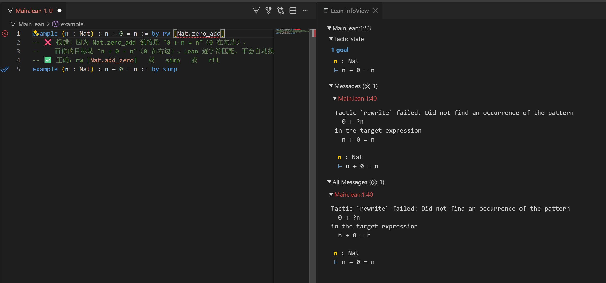

**教训**：`rw` 用的引理必须与目标**逐字匹配**（方向也要对）。找引理用：

### 12.3 `#check` 查引理：Lean 的"查字典"

```lean
#check @Nat.add_comm
-- 输出：Nat.add_comm : ∀ (n m : Nat), n + m = m + n
-- 读法：对任意自然数 n m，n + m = m + n。@ 表示"显示全部参数"。

#check @Nat.add_zero    -- ∀ (n : Nat), n + 0 = n
#check @Nat.zero_add    -- ∀ (n : Nat), 0 + n = n
```

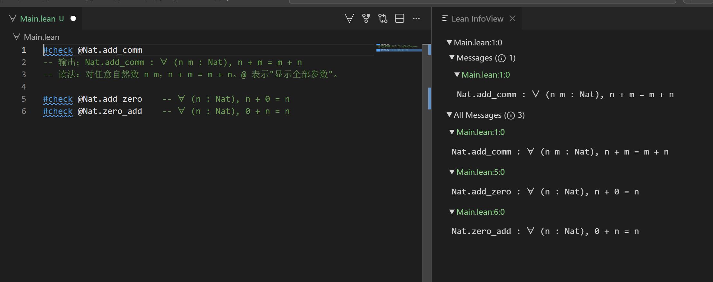

`#check @某引理` 就是 Lean 的"查字典"：先查到引理的**精确陈述**，再去 `rw`/`exact`，命中率立刻上升。

### 12.4 完整体验一次归纳证明

```lean
example (n : Nat) : n + 0 = n := by
  induction n with
  | zero => rfl                    -- 基础情形：n = 0，即 0 + 0 = 0，定义即相等
  | succ k ih => simp              -- 归纳情形：k+1，即 (k+1) + 0 = k+1
     -- ih（induction hypothesis，归纳假设）: k + 0 = k
     -- 注意：本例的归纳情形 simp 借助 Nat.add_zero 自己就能关闭，其实用不到 ih；
     -- 真正必须借助 ih 的完整例子见第 13 章练习 5
```

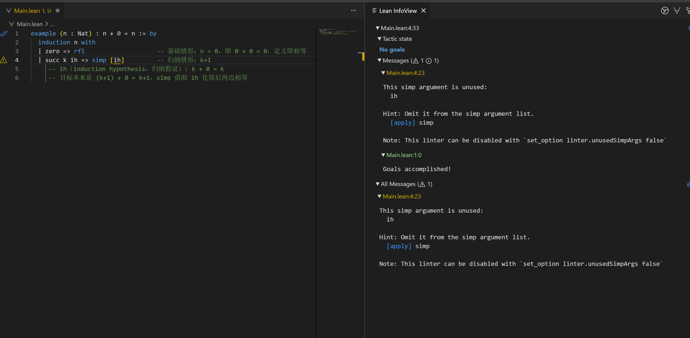

**操作建议**：把这四行粘贴后，**把光标逐行往下移**，盯着 Infoview：
- 光标在 `induction` 行时：目标 `n + 0 = n`；
- 光标在 `rfl` 行时：目标分成两个（`0 + 0 = 0` 和 `(k+1)+0 = k+1`）；
- 光标在 `simp` 行时：显示 "No goals"，**证完了**。

这个例子同时揭示了一个秘密：**"证明程序"里，`ih` 是一个可以拿来用的变量**，归纳假设不是玄学，是编译器发给你的现成武器。对照上篇第 2.4 节的 `sum_formula`，你已经能完全读懂它的每一步了。

## 第 13 章　练习（由浅入深，附逐步解析）

> 练习都写在 `Main.lean` 里（或把模板内容替换掉）。每个练习先自己试 10 分钟，再看解析。**提示：练习里 `#eval` 结果都给出了，方便你对答案。**

### 练习 1（热身）：函数与求值 ★

定义函数 `cube`：求立方。要求：写出定义、`#eval cube 7`（应得 343）、`#check cube`。

<details>
<summary>参考答案与解析（先自己写！）</summary>

```lean
def cube (n : Nat) : Nat := n ^ 3
#eval cube 7     -- 343
#check cube      -- cube : Nat → Nat
```

解析：`(n : Nat)` 是参数及类型，第二个 `: Nat` 是返回类型，`:= n ^ 3` 是定义体。`^` 是乘方（Python 的 `**`）。对照 Python：`def cube(n): return n ** 3`。
</details>

### 练习 2（递归）：幂函数 ★★

用**模式匹配 + 递归**实现 `myPow (b : Nat) (e : Nat) : Nat`（b 的 e 次方，e 为自然数）。不许用 `^`。验证 `#eval myPow 2 10` 得 1024。

<details>
<summary>参考答案与解析</summary>

```lean
def myPow (b : Nat) : Nat → Nat
  | 0 => 1
  | e + 1 => b * myPow b e

#eval myPow 2 10    -- 1024
#eval myPow 3 4     -- 81
```

解析：固定底数 b，对指数递归。指数为 0 时结果是 1（基础情形）；指数为 e+1 时结果是 `b × b^e`（归纳情形）。注意参数顺序写法：`def myPow (b : Nat) : Nat → Nat` 中 b 是固定参数，模式匹配只作用在第二个参数上。**注意 Lean 这里不会有任何"溢出"担忧**，Nat 是精确自然数，你可以放心 `#eval myPow 2 100`（结果是 31 位数）。

自检题：这个递归为什么保证终止？因为每次调用 e 严格变小（e+1 → e），编译器的终止检查就是这么看的。
</details>

### 练习 3（列表）：最大值 ★★

用模式匹配实现 `myMax : List Nat → Nat`，空表返回 0，非空返回最大元素。验证 `#eval myMax [3, 9, 4]` 得 9。

<details>
<summary>参考答案与解析</summary>

```lean
def myMax : List Nat → Nat
  | [] => 0
  | x :: xs => let m := myMax xs      -- 先算出剩余部分的最大值 m
               if x > m then x else m  -- 再跟当前元素比

#eval myMax [3, 9, 4]     -- 9
#eval myMax ([] : List Nat)  -- 0
```

解析：`x :: xs` 把列表拆成首元素和尾部。`let m := ...` 是局部定义（类比 Python 的临时变量）。`if x > m then x else m` 就是三目。两个知识点：①`myMax xs` 是递归调用，列表每次变短 → 终止有保障；②空表时 `myMax [] = 0` 隐含约定（0 恒小于任何元素，所以含 0 的表不受影响；严格的写法应返回 `Option Nat`，正是 11.5 节 `safeHead` 的思路，留作选做：改写 `myMax' : List Nat → Option Nat`）。
</details>

### 练习 4（证明入门）：三个定理 ★★★

不查任何资料，证明以下三条（允许用 `rfl` / `simp` / `rw` / `decide` 任意组合）：

```lean
-- (a) 5 + 5 = 10
-- (b) 对任意 n：0 * n = 0 * n   （提示：任何东西等于它自己）
-- (c) 对任意 a b : Nat：a * b = b * a
```

<details>
<summary>参考答案与解析</summary>

```lean
-- (a) 数字具体 → 直接算
example : 5 + 5 = 10 := by decide       -- 或 rfl

-- (b) 左右本来一字不差 → rfl（"任何东西等于它自己"）
example (n : Nat) : 0 * n = 0 * n := by rfl

-- (c) 变量乘法交换 → 查字典找到 Nat.mul_comm，用 rw 重写
example (a b : Nat) : a * b = b * a := by rw [Nat.mul_comm]
```

解析：三个答案对应三种典型情形，**具体数字**（算：decide/rfl）、**字面恒等**（自反：rfl）、**一般规律**（查引理+重写：rw）。做 (c) 时的标准动作：先 `#check @Nat.mul_comm` 确认引理陈述，再 `rw`。乘法交换在 Nat 上**不能**用 `rfl`（`a*b` 和 `b*a` 定义上不同，一个按 a 展开、一个按 b 展开），必须用真引理。体会：`rfl` 的边界 = 定义的直接化简范围。
</details>

### 练习 5（归纳证明，挑战题）：亲手重建加法交换律 ★★★★

上一章 `rw [Nat.add_comm]` 一行搞定交换律，但那是在**引用**别人证的定理。现在你亲手证一遍。先证两个小引理，再合成大定理（顺序做，别跳）：

```lean
-- 5.1 对任意 n：n + 0 = n        （提示：induction + rfl + simp [ih]）
-- 5.2 对任意 a b：a + (b+1) = (a+b) + 1   （提示：对 a 归纳）
-- 5.3 终极目标：对任意 a b：a + b = b + a   （对 b 归纳，用 5.1 和 5.2）
```

<details>
<summary>参考答案与解析</summary>

```lean
-- 5.1
theorem my_add_zero (n : Nat) : n + 0 = n := by
  induction n with
  | zero => rfl                       -- 0 + 0 = 0，定义即相等
  | succ k ih => simp                 -- (k+1)+0 = k+1，simp 自动关闭

-- 5.2
-- 这条看似需要归纳，实际上它是定义层面的引理 Nat.add_succ 的翻版，直接引用即可：
theorem my_add_succ (a b : Nat) : a + (b + 1) = (a + b) + 1 := Nat.add_succ a b

-- 5.3
theorem my_add_comm (a b : Nat) : a + b = b + a := by
  induction b with
  | zero => rw [Nat.add_zero, Nat.zero_add]          -- 两侧各归约一步：a+0=a、0+a=a
  | succ k ih => simp [Nat.succ_add, my_add_succ, ih] -- 两侧各自展开后由 ih 接上

-- 自检：编译通过、Infoview 显示 No goals，你就独立重建了一条数学定理。
```

解析（值得细读）：
- **5.1** 是"对第二个参数的加 0"，注意它和第 12 章 `0 + n = n` 方向相反，后者是定义直接给出（`Nat.add` 按第一个参数匹配），前者需要归纳。这解释了为什么库里两个引理都存在。归纳情形里 `simp` 不需要 ih，因为 `(k+1) + 0` 直接匹配 `Nat.add_zero`。
- **5.2** 教你先查字典再动手：先 `#check @Nat.add_succ`，会发现它正是 `n + (m + 1) = (n + m) + 1`，与目标逐字同型，直接当证明项用。看似要归纳的命题常常有现成的定义级引理。
- **5.3** 对 b 归纳：基础情形 b=0，左侧用 `Nat.add_zero`、右侧用 `Nat.zero_add`；归纳情形中 `(k+1) + a` 由 `Nat.succ_add` 展开、`a + (k+1)` 由 5.2 展开，ih 把 `a + k` 换成 `k + a` 后两边相遇。
- ⚠️ **实操警告**：不要对形如 `(k+1) + 1` 的目标使用 `Nat.succ_add`，它会产生"左边等于右边"的恒等重写，令 `simp` 无限递归，报 `maximum recursion depth has been reached`。遇到含 `+1` 嵌套的线性目标，直接 `omega` 更稳妥。
- **彩蛋**：现代 Lean 自带线性算术求解器 `omega`，`theorem cheat (a b : Nat) : a + b = b + a := by omega` 一行完事。但**手写归纳的价值在于理解证明的结构**，这恰是上篇所述"指挥 AI、判断它哪步在糊弄"的基本功。
</details>

## 第 14 章　日常使用报错速查（第 10~13 章中可能遇到）

| 症状 | 原因 | 解决 |
|---|---|---|
| 一整行红色下划线 "unknown identifier 'x'" | 用了未定义的名字 | 检查拼写、确认定义在**使用之前**（Lean 从上往下读） |
| "type mismatch" | 类型不匹配 | 读错误信息里的"expected / has type"，多半是 Nat/Int/Float 混用 |
| "declaration uses 'sorry'" 黄色警告 | 有 `sorry` 占位 | 正常现象，写完消掉即可（见 11.7 与上篇 2.3） |
| `rw` 报 "motive is not type correct" 或 "rewrite failed" | 引理与目标不逐字匹配 | `#check @引理名` 核对陈述方向；或换 `simp` |
| 递归报 "fail to show termination" | 终止性存疑 | 确认每次递归参数在变小（用 `n+1` 模式或明确减法） |
| Infoview 卡住不更新 | 服务器抽风 | `Ctrl+Shift+P` → `Lean: Restart File` |
| 修改后满屏旧报错 | 文件状态过期 | 同上，Restart File；或 `lake build` 看终端里的真实错误 |
| 明明改了代码，`lake build` 却显示成功，错误像消失了一样 | 增量缓存未察觉文件变更（Windows 偶发，本教程写作时就真实遇到过：文件已改坏，`lake build` 仍报成功） | 用 `lake env lean 文件路径` 强制完整重查该文件，以它的输出为准；必要时删除项目下 `.lake\build` 目录后重新 `lake build` |
| 在 `Hello\` 子目录运行 lake 报 "no configuration file" | lakefile 在项目根目录 | 回到有 `lakefile.toml` 的项目根目录再执行（见 10.1 的坑） |
| 报 "unexpected token '}'; expected term"，位置在 `{ι : Type*}` 这类绑定器附近，但那一行明明没有语法错误 | 文件忘了 `import Mathlib`：`Type*` 等记号是 mathlib 提供的语法扩展，没导入时解析器在别处崩溃，报错位置有误导性 | 补上 `import Mathlib`（第三部分写统计代码时最常见，因为文件头注释一长容易把 import 挤掉） |
| 报 "unexpected token 'section'; expected 'lemma'" | 文档注释 `/-!` 或 `/-- ... -/` 挂在了 `section` 等结构命令上，它们只能挂定理和定义 | 把说明改成普通注释（`--`），文档注释移到下一个定理头上（见 18.1 例 2b） |

## 第 15 章　后续学习路线与资源

### 15.1 推荐顺序

1. **Natural Number Game**（强烈首推）：把第 12 章的 tactic 变成闯关游戏，从 `0 + n = n` 一路证明到乘法交换律，全程浏览器里做、零安装。搜索 "Natural Number Game Lean 4" 进入当前官方入口。
2. **Theorem Proving in Lean 4**（官方教材，免费在线）：https://lean-lang.org/theorem_proving_in_lean4/ ，系统学类型、证明、tactic 的"字典书"。
3. **Functional Programming in Lean**（官方，免费在线）：https://lean-lang.org/fp_lean/ ，把 11.4/11.5 节的函数式编程讲深讲透。
4. **Mathematics in Lean**（社区教程）：https://leanprover-community.github.io/mathematics_in_lean/ ，面向"用 Lean 做数学"的读者，实数、分析、概率都有，是第三部分统计证明所需的 mathlib 预备知识。
5. **Mathlib**（数学超库）：https://github.com/leanprover-community/mathlib4 ，150 万行社区数学库。安装方法见《AI 赋能统计研究-实操演示方案》README §4（`lake new 项目名 math` 模板一步到位），工程细节另见上篇 4.4。
6. **社区问答**：Zulip 聊天室 https://leanprover.zulipchat.com （提问前先搜历史）；引理搜索 https://moogle.ai （自然语言查 Mathlib）；在线试玩 https://live.lean-lang.org （零安装跑 Lean）。

### 15.2 与本系列演示的衔接

学完本篇 + Natural Number Game 后，你已经能看懂并跟做《AI 赋能统计研究》第 1 集的全部操作，也就是上篇第 2 章工作流的人工版本：

| 演示中的动作 | 对应本篇知识点 | 对应上篇 |
|---|---|---|
| `Demo.lean` 里的 `sorry` | 11.7 节 | 2.3 节 sorry 骨架法 |
| `ring` / `nlinarith` | 第 12 章 tactic 思想（它们是更强的自动化版本，同属 tactic 家族） | 2.4 节的"自动化战术" |
| 把数学陈述翻译成 Lean 陈述 | 第 12 章 + `#check` 查引理 | 第 4 章"陈述形式化" |
| 编译报错回喂 AI | 第 14 章报错速查，你看得懂报错，才能指挥 AI | 第 2 章"编译器即裁判" |
| Mathlib 项目 `lake exe cache get` | 15.1 第 5 条 | 4.4 工程环境 |

---

# 第三部分｜证明统计定理

> **本篇前提**：已完成下篇（第 9~15 章），能在核心 Lean 里写函数与归纳证明。本篇解决一个现实问题：统计命题涉及实数、测度、积分、概率，这些都不在 Lean 核心里，而在 mathlib。本篇带你完成 mathlib 的安装配置（含国内网络的完整排坑记录，均为实操真实经历），再通过三个统计结论的完整证明，把"论文命题 → Lean 陈述 → 编译通过"的流程走通。

## 第 16 章　安装与配置 mathlib

### 16.1 为什么必须装 mathlib

Lean 核心只内置了 `Nat` / `Int` 的算术与基础逻辑。统计学需要的实数系 `ℝ`、测度与积分（`MeasureTheory`）、概率分布、极限与收敛，全部位于 mathlib。这也是 mathlib 有 150 万行之巨的原因：它把大学数学的主要内容都形式化了，你的论文定理大概率能站在它上面。

版本机制上有一条铁律：**lean-toolchain 锁定的 Lean 版本与 mathlib 版本一一对应**。mathlib 几乎每天都有新版本，升级 mathlib 就意味着升级 Lean，两者由 `lake update` 自动对齐，不要手动改 `lean-toolchain`。

### 16.2 创建项目：math 模板

在纯英文路径下（理由见 9.1）：

```powershell
D:
cd D:\lean
lake new statdemo math
cd statdemo
```

`math` 是 lake 内置模板，它会生成两样关键东西：依赖 mathlib 的 `lakefile.toml`，以及与之匹配的 `lean-toolchain`。注意与 10.1 的坑相反，**`lake new` 会创建子目录**（`lake init` 在当前目录初始化），这正是本教程推荐用它的原因。

### 16.3 拉取依赖与预编译缓存

```powershell
lake update          # 获取 mathlib 源码（首次数百 MB，几分钟到几十分钟）
lake exe cache get   # 下载与当前版本匹配的预编译 olean（约 2 GB）
lake build           # 校验缓存并构建你的项目
```

**为什么必须用缓存**：如果不用，`lake build` 会从源码编译整个 mathlib，耗时数小时且极耗内存。`lake exe cache get` 从 mathlib 官方缓存服务（cache.mathlib.org）下载已经编译好的产物，把首次构建压缩到几分钟。代价是约 2 GB 下载量，这是国内用户最容易翻车的环节。

**网络实战排坑记录**（写作本教程时真实发生，供对照）：

| 症状 | 原因 | 解法 |
|---|---|---|
| `CONNECT tunnel failed, response 502` | 终端环境变量 `$env:HTTP_PROXY` 指向失效端口（如某软件残留的 63671），而系统代理实际在 7897 | 用系统代理真实端口覆盖环境变量：`$env:HTTP_PROXY="http://127.0.0.1:7897"; $env:HTTPS_PROXY=$env:HTTP_PROXY`，并在同一终端里执行后续命令 |
| `git ls-remote` 能通，`git fetch` 大传输持续 502 | 代理对 git 智能协议的大包传输不稳定 | 改用 curl 下载源码压缩包（支持断点续传），解压后直接放进依赖目录，绕开 git 传输（见下） |
| `lake exe cache get` 中断 | 下载量太大被掐断 | 直接重跑，续传或补齐；必要时对单个发布文件用 `curl.exe -L -C -` 手工续传 |

git 大传输失败的绕过方案（版本号以 `lake update` 报错信息里显示的 revision 为准，如 `fetching revision 'v4.35.0'`）：

```powershell
# 在 statdemo 目录下执行
curl.exe -L -C - -o mathlib-src.tar.gz "https://codeload.github.com/leanprover-community/mathlib4/tar.gz/refs/tags/v4.35.0"
tar -xzf mathlib-src.tar.gz
# 删除拉取不完整的 .lake\packages\mathlib，把解压出的 mathlib4-4.35.0 移动为 .lake\packages\mathlib
```

实测该仓库源码压缩包仅约 23 MB，curl 一把即过，而 git fetch 反复失败。工具选对比传输稳定性影响巨大。

### 16.4 验证安装

把 `Statdemo/Basic.lean` 整个替换为：

```lean
import Mathlib

example (a b : ℝ) (h : a ≤ b) : a + 1 ≤ b + 1 := by linarith
```

然后：

```powershell
lake env lean Statdemo\Basic.lean
```

零输出即成功（或 VS Code 打开无红线）。`linarith` 是 mathlib 的线性实数算术战术，Lean 核心没有，它能工作就证明 mathlib 已就位。注意这是实数 `ℝ` 上的不等式，核心版的 `omega` 只管整数与自然数，管不了 `ℝ`。

### 16.5 日常使用与维护

- **单文件检查**：日常写证明时用 `lake env lean Statdemo\Basic.lean`（或在 VS Code 里看 Infoview），不要每次全量 `lake build`；
- **更新 mathlib**：顺序固定为 `lake update` → `lake exe cache get` → `lake build`；
- **缓存版本错位**：如果 `lake update` 升级了 mathlib 而缓存没跟上，编译会出现大量"找不到 olean"或直接开始从源码编译，重跑 `lake exe cache get` 即可。

---

## 第 17 章　mathlib 快速上手：查引理、读签名、搭证明

上篇第 5 章说过，AI 团队产出证明的套路是"先把大定理拆成已知结论的组合"。在 Lean 里，"已知结论"就是 mathlib 的引理库。本章解决三个实操问题：统计学内容在 mathlib 的哪里、怎么查、怎么读。

### 17.1 统计学住在 mathlib 的哪一层

mathlib 没有独立的"统计学"模块，统计学的地基（测度论、概率论、积分）都在 `MeasureTheory` 命名空间下。对我们最有用的三个概念是：

| 概念 | mathlib 中的写法 | 含义 |
|---|---|---|
| 概率空间 | `{Ω : Type*} [MeasurableSpace Ω] {μ : Measure Ω}` 加 `[IsProbabilityMeasure μ]` | 样本空间 Ω、事件 σ-代数、概率测度 μ |
| 随机变量 | `f : Ω → ℝ`（配 `Measurable f`） | 从样本空间到实数的函数 |
| 期望 | `∫ x, f x ∂μ` | 测度论积分。对概率测度而言，积分就是期望 E[X] |
| 可积 | `Integrable f μ` | 期望存在的最低门槛假设 |

两点初学者最容易困惑的地方，先说清楚：

1. **`∫ x, f x ∂μ` 就是期望，没有单独的 `E[X]` 记号**。mathlib 有 `expectation` 这个记号别名（在概率命名空间里），但底层全是积分引理。记住"期望 = 关于概率测度的积分"，查引理时去搜 `integral_*` 而不是 `expectation_*`，命中率天差地别。
2. **假设要显式给**。纸面上我们写"E[X] = E[X] + E[Y]"，默认了 X、Y 可积。Lean 里这个默认不存在：`integral_add` 的签名要求你把可积性作为参数递进去。形式化比纸面更啰嗦，是因为它不允许任何"显然"。

### 17.2 三种查引理的方式，按效率排序

**方式一：`#check` 加猜名字**。mathlib 命名规律性很强：积分线性性是 `integral_add`，常数提出是 `integral_const`，有限和提出是 `integral_finsetSum`。试着敲：

```lean
import Mathlib
open MeasureTheory

#check integral_add
#check integral_const
#check integral_const_mul
```

Infoview 会打印完整签名，比如 `integral_add : Integrable f μ → Integrable g μ → ∫ a, (f a + g a) ∂μ = ∫ a, f a ∂μ + ∫ a, g a ∂μ`。看到箭头链就知道要提供哪些假设。

**方式二：`exact?`**。写完定理陈述，把证明先填成 `by exact?`，Lean 会搜索所有能一步闭合目标的引理并给出建议。适合"我确信 mathlib 有这个结论，但不知道叫什么"的场景。缺点是搜索慢（几十秒），且目标陈述必须和引理几乎一字不差。

**方式三：在线文档与搜索引擎**。mathlib 官方文档站（leanprover-community.github.io）按命名空间列出全部声明；moogle.app 和 lean search 支持用陈述片段（甚至 LaTeX）模糊搜索。离线场景下，`exact?` 加猜名字足够覆盖本章需求。

### 17.3 读签名：箭头链就是"使用说明书"

以本章最常用的三个引理为例，注意签名细节决定用法：

```lean
#check @integral_add
-- integral_add : ∀ {α} {m : MeasurableSpace α} {μ : Measure α}
--     {f g : α → ℝ}, Integrable f μ → Integrable g μ →
--     ∫ a, (f a + g a) ∂μ = ∫ a, f a ∂μ + ∫ a, g a ∂μ

#check @integral_const_mul
-- integral_const_mul : ∀ {α} {L} [RCLike L] (r : L) {f : α → L},
--     ∫ a, r * f a ∂μ = r * ∫ a, f a ∂μ

#check @integral_finsetSum
-- integral_finsetSum : ∀ {ι} {α} {μ} (s : Finset ι) {f : ι → α → ℝ},
--     (∀ i ∈ s, Integrable (f i) μ) →
--     ∫ a, ∑ i ∈ s, f i a ∂μ = ∑ i ∈ s, ∫ a, f i a ∂μ
```

三件事值得专门指出来：

1. **花括号参数是隐式的**。`integral_add` 的类型参数（α、μ、f、g）由 Lean 从你的目标里自动推断，你只需要显式提供箭头后面的 `Integrable` 假设。
2. **`integral_const_mul` 不要求可积**。它的结论是关于 `∫ a, r * f a ∂μ` 这个积分本身的等式，两边同时存在或同时发散。这是查签名才能发现的细节：猜"肯定要 Integrable"反而会写多余的假设。
3. **假设是逐点的**。`integral_finsetSum` 不要求每个 `f i` 全局可积，只要求 `∀ i ∈ s`：对求和范围内的 i 可积。mathlib 的引理普遍把假设精确到最小必要，读签名时留意量词位置。

### 17.4 概率测度：`IsProbabilityMeasure` 与它的红利

很多统计性质依赖 `P(Ω) = 1`。mathlib 用类型类 `[IsProbabilityMeasure μ]` 表达，它自带一批 simp 引理，最关键的是 `probReal_univ : μ.real univ = 1`（全空间概率为 1）。写法上用 `variable` 加 section 作用域控制：

```lean
section
variable [IsProbabilityMeasure μ]   -- 本 section 内所有定理默认享受概率测度

-- 在这里写的定理可以把 P(Ω) = 1 当作已知

end
```

`IsProbabilityMeasure` 挂在 `μ` 上而不是作为普通参数传入，好处是调用定理时不用手动传：Lean 会从目标里的 μ 自动实例化。

### 17.5 第一次组合 mathlib 引理：E[X + c] = E[X] + c

这是第 18 章正式代码的预演，完整走一遍"组合引理"的思维过程。目标：

```lean
theorem expectation_add_const (f : Ω → ℝ) (hf : Integrable f μ) (c : ℝ) :
    ∫ x, (f x + c) ∂μ = ∫ x, f x ∂μ + c := by
  rw [integral_add hf (integrable_const c), integral_const]
  simp
```

逐行拆解：

1. **计划**：左边是"函数加常数"的积分。把它拆成两块：`f x` 的积分（就是目标右边的第一项）和常数 `c` 的积分。这正是 `integral_add` 干的事，但 `integral_add` 需要两侧都可积：`f` 侧用 `hf`，常数侧用 `integrable_const c`（mathlib 里常数函数永远可积）。
2. **`rw [integral_add hf (integrable_const c)]`**：把左边重写成 `∫ f ∂μ + ∫ c ∂μ`。注意我们同时把可积性证明"喂"了进去，重写和引用假设是一步完成的。
3. **`rw [integral_const]`**：引理 `integral_const : ∫ _ : α, c ∂μ = μ.real univ • c` 把常数积分化成 `μ.real univ • c`（全空间测度乘常数）。
4. **`simp`** 收尾：在概率测度下，`probReal_univ` 把 `μ.real univ` 化成 1，`1 • c` 化成 `c`，两边相等。

整个证明只做了"两步重写加一步化简"。这就是 mathlib 时代的证明风格：不是从公理开始堆，而是找到正确的引理序列。AI 在这件事上极擅长（上篇 2.3 的机制），因为"从目标形状联想引理名"本质上是模式匹配加检索。

---

## 第 18 章　形式化并证明统计结论：期望性质与样本均值

本章给出两组可以直接编译运行的完整代码：测度论侧的期望四性质（对应 `statdemo/Scratch1.lean`）和纯代数侧的样本均值两性质（对应 `statdemo/Scratch2.lean`）。全部定理在本文档写作时于 Lean 4.35.0 + mathlib 逐行编译验证通过，验证方法与真实输出见附录 B。

### 18.1 期望四性质（测度论侧）

```lean
import Mathlib

open MeasureTheory

variable {Ω : Type*} [MeasurableSpace Ω] {μ : Measure Ω}

/-- 例 1：期望的线性性 -/
theorem expectation_add (f g : Ω → ℝ) (hf : Integrable f μ) (hg : Integrable g μ) :
    ∫ x, f x + g x ∂μ = ∫ x, f x ∂μ + ∫ x, g x ∂μ :=
  integral_add hf hg

/-- 例 2：期望的齐次性 E[cX] = c·E[X]（无需可积性） -/
theorem expectation_const_mul (c : ℝ) (f : Ω → ℝ) :
    ∫ x, c * f x ∂μ = c * ∫ x, f x ∂μ :=
  integral_const_mul c f

-- 例 2b：期望的平移性 E[X + c] = E[X] + c（需要概率测度：P(Ω) = 1）
-- 注意：文档注释（/-- ... -/）只能挂在定理或定义上，挂在 section 上会报
-- "unexpected token 'section'; expected 'lemma'"，所以这里用普通注释。
section
variable [IsProbabilityMeasure μ]

theorem expectation_add_const (f : Ω → ℝ) (hf : Integrable f μ) (c : ℝ) :
    ∫ x, (f x + c) ∂μ = ∫ x, f x ∂μ + c := by
  rw [integral_add hf (integrable_const c), integral_const]
  simp

end

/-- 例 3：有限和的期望等于期望的有限和 -/
theorem expectation_finsetSum {ι : Type*} (s : Finset ι) (f : ι → Ω → ℝ)
    (hf : ∀ i ∈ s, Integrable (f i) μ) :
    ∫ x, ∑ i ∈ s, f i x ∂μ = ∑ i ∈ s, ∫ x, f i x ∂μ :=
  integral_finsetSum s hf
```

注意四个定理的证明形态：例 1、2、3 是"项模式"直接引用 mathlib 引理（`:=` 后面直接写引理名加假设参数，没有 `by`），只有例 2b 需要重写。这不是偷懒，恰恰说明这几个统计性质在 mathlib 里已经是"一等公民"，我们要做的只是正确地调用。

### 18.2 从四性质到无偏性：样本均值期望的推论

有了例 3，统计学里最常用的一个事实只剩一步代数：**样本均值的期望等于各分量期望的平均**（无偏性的核心代数）。

```lean
/-- 例 3 推论：样本均值的期望等于各分量期望的平均 -/
theorem expectation_sampleMean {ι : Type*} (s : Finset ι)
    (f : ι → Ω → ℝ) (hf : ∀ i ∈ s, Integrable (f i) μ) :
    ∫ x, (∑ i ∈ s, f i x) / s.card ∂μ = (∑ i ∈ s, ∫ x, f i x ∂μ) / s.card := by
  have h : (∫ x, (∑ i ∈ s, f i x) / s.card ∂μ)
      = ∫ x, (1 / s.card) * (∑ i ∈ s, f i x) ∂μ := by
    congr 1
    funext x
    ring
  rw [h, integral_const_mul, integral_finsetSum s hf]
  ring
```

证明思路值得细看，因为它是"引理组合"的典型三段式：

1. **整理形状（`have h`）**：mathlib 的 `integral_const_mul` 认识的是 `c * f x`，不认识 `f x / n`。先用逐点代数把 `(∑ f x) / n` 改写成 `(1/n) * (∑ f x)`。`congr 1` 把两个积分相等的目标降为被积函数相等，`funext x` 再降到每个点的值相等，`ring` 收掉纯代数等式。
2. **提出常数与和（`rw`）**：`integral_const_mul` 把 `1/n` 提出积分，`integral_finsetSum` 把求和提出积分，一步之后目标变成 `((1/n) • ∑ ∫ f) = (∑ ∫ f) / n`。
3. **`ring` 收尾**：剩下的又是纯代数。

中间那行 `have h ... := by congr 1; funext x; ring` 是一个通用手法：当你要重写的等式两边"差一点形状"时，先把它自己作为一个小引理证出来，再 `rw` 进主目标。AI 写证明时几乎总是先尝试直接 `rw`，失败后回落到这个手法，第 20 章的演示会展示这个回落过程。

### 18.3 样本均值的代数性质（不碰测度论的半边天）

第二组代码完全不需要测度论，把"样本均值"当纯代数对象处理，适合作为 mathlib `Finset` 求和引理的练手材料：

```lean
import Mathlib

/-- 样本均值：有限观测集合上函数值的算术平均 -/
noncomputable def sampleMean {ι : Type*} (s : Finset ι) (f : ι → ℝ) : ℝ :=
  (∑ i ∈ s, f i) / s.card

/-- 平移协变性：整体加 c，均值加 c（需要非空：空集时 0 = c 不成立） -/
theorem sampleMean_add_const {ι : Type*} (s : Finset ι) (hs : s.Nonempty)
    (f : ι → ℝ) (c : ℝ) :
    sampleMean s (fun i => f i + c) = sampleMean s f + c := by
  have hcard : (s.card : ℝ) ≠ 0 := by exact_mod_cast ne_of_gt (Finset.card_pos.mpr hs)
  rw [sampleMean, sampleMean, Finset.sum_add_distrib, Finset.sum_const, nsmul_eq_mul, add_div]
  field_simp

/-- 齐次性：整体乘 k，均值乘 k。注意无需非空假设：Lean 的实数约定 a/0 = 0，
    空集退化情形 0 = k·0 也成立，这是形式化才会暴露的细节。 -/
theorem sampleMean_const_mul {ι : Type*} (s : Finset ι) (f : ι → ℝ) (k : ℝ) :
    sampleMean s (fun i => k * f i) = k * sampleMean s f := by
  rw [sampleMean, sampleMean, ← mul_div_assoc k, Finset.mul_sum]
```

三个值得注意的细节：

1. **`s.Nonempty` 不是可有可无的洁癖**。空集的 `card = 0`，样本均值分母为零。纸面统计里我们从不说"假设 n ≥ 1"，因为默认了；Lean 强迫把默认写出来。这个假设被 `exact_mod_cast` 转换成实数版的 `hcard : (s.card : ℝ) ≠ 0`（自然数序保持到实数强制转换），供 `field_simp` 做分母消去时使用。
2. **两个定理对非空的依赖并不对称，这是形式化才会暴露的**。平移协变性在空集上变成 `0 = c`，必须靠 `hs` 排除；齐次性在空集上是 `0 = k * 0`，恰好成立，所以连假设都不需要。原因在于 Lean 的实数把 `a / 0` 定义为 0（数学上的"未定义"在类型论里必须给值），这个约定让退化情形自动满足。写初稿时我们给两个定理都加了 `hs`，编译器的 unused-variable 警告揭示了不对称，随后按事实修正。这就是"编译器当审稿人"的日常。
3. **`noncomputable def`**：实数除法在 Lean 里不是可执行代码（实数是数学对象而非浮点数），所以标记 `noncomputable`，告诉编译器"这个定义只参与证明，不参与计算"。

### 18.4 从纸面统计到 Lean 代码的翻译清单

把一条纸面统计结论变成 Lean 陈述，照这张清单走：

| 步骤 | 要回答的问题 | 本章例子中的对应 |
|---|---|---|
| 1. 圈定论域 | 结论在有限集上还是概率空间上成立？ | 平移协变性：有限集；无偏性：概率空间 |
| 2. 写出全部隐藏假设 | 可积？非空？n ≥ 1？ | `Integrable`、`s.Nonempty`、`IsProbabilityMeasure` |
| 3. 翻译词汇 | 论文记号对应 mathlib 什么名字？ | E[X] → `∫ x, f x ∂μ`，x̄ → `sampleMean` |
| 4. 查引理 | 结论本身或主要步骤是否已是 mathlib 引理？ | `integral_add`、`integral_finsetSum` |
| 5. 写陈述、让 `exact?` 试一步 | 一步能闭合就直接引用 | 例 1、2、3 |
| 6. 不能闭合则规划重写序列 | 目标形状和引理形状差在哪？ | 例 2b 的两步 `rw`，18.2 的 `have h` |

第 4 步是 AI 增益最大的一步（检索 + 模式联想），第 2 步是 AI 最容易出错的一步（它倾向于省略假设让陈述"看起来干净"，导致证不出来或陈述变弱）。第 19 章的 skill 设计会针对这两点分别给出机制。

---

# 第四部分｜AI 自动化证明 skill 设计

## 第 19 章　lean-proof skill：把第 2 章的机制封装成工具

上篇 2.3 给出了 AI 与 Lean 协作的机制图：AI 产代码，Lean 当裁判，错误信息回流。本章把这个机制落成一个可复用的 skill（提示词工程 + 工具约定），目录结构随本文档配套开源（`skill/lean-proof/`），可直接放进支持 skill 机制的 AI 工具，也可以把 SKILL.md 当作给任何 AI 助手的系统提示词模板。

### 19.1 设计目标与能力边界

skill 只做一件事：**给定一条数学或统计陈述，产出一份通过 Lean 4 内核检查的完整证明文件**。边界同样重要，先划清楚：

| 能做 | 不能做 |
|---|---|
| 把清晰的自然语言陈述翻译成 Lean 陈述 | 替你决定研究哪条定理（选题是人的事） |
| 把证明拆成 sorry 骨架并逐个填充 | 保证任意猜想可证（假命题会被编译器拒绝，这是特性不是缺陷） |
| 读编译错误自主修错、重试 | 在陈述本身有歧义时擅自"脑补"语义（必须回头向人确认） |
| 终检并如实报告 sorry 与公理依赖 | 掩盖未完成部分（诚实条款，见 19.4） |

### 19.2 四阶段流水线

**阶段 A：陈述形式化**。把自然语言陈述转成 Lean 定理陈述，只写签名不写证明。此阶段的关键约束：所有量词、假设、类型显式化；逐项向用户（或向上层 agent）确认翻译无损。产出示例见 20.1 的第一步。

**阶段 B：sorry 骨架**。若目标是一条复合定理（比如"样本均值无偏"要经过"和的期望"与"常数提出"两步），先把它拆成引理链，每个引理暂时以 `sorry` 占位，确认整条链编译通过（没有类型错误、没有歧义）。这一步等价于上篇 2.3 说的"先把骨架立起来"。`sorry` 在这里是合法的脚手架，因为 Lean 会持续警告它存在，不会让占位符混进最终结果。

**阶段 C：逐引理填充循环**。对骨架里的每个 `sorry`，执行固定循环：

```
1. 尝试现成引理：exact? 或按命名规律猜测 integral_*/Finset.sum_* 系列
2. 失败则写重写序列：rw / simp / ring / field_simp / omega
3. 每次修改后立即用 lake env lean 单文件验证（反馈接口见 19.3）
4. 同一引理连续失败达 8 次：停止蛮力，升级处理
```

升级处理（escalation）是本 skill 与"无脑重试"的分水岭，按序尝试：换引理（同结论不同名的引理在 mathlib 里很常见）；降级拆分（把引理再拆成更小的引理）；重构陈述（检查是否假设不足或过强）；最后如实报告卡点，把决策交还给人。第 20 章演示二的"field_simp 卡壳与解锁"就是这个路径的真实记录。

**阶段 D：终检**。全部 `sorry` 清零后执行三件事：`#print axioms 定理名`（确认只依赖标准公理，没有意外引入 `sorryAx`）；`grep sorry`（文件级扫描，防止藏在注释外的残留）；以 `lake env lean` 最终退出码为准出报告。

### 19.3 反馈接口：为什么是 `lake env lean` 而不是 `lake build`

循环的每一圈都需要一个机器可读的裁决。本 skill 选 `lake env lean 文件路径`，理由有三：

1. **绕开增量缓存**。`lake build` 存在缓存未察觉文件变更而虚报成功的陷阱（附录 B 有真实案例），单文件强制检查每次都真刀真枪重新类型检查。
2. **反馈结构干净**。输出是标准化的 `文件:行:列: error: ...` 流，AI 可以直接解析出错误类别（unknown identifier / type mismatch / tactic failed）定位到行。
3. **反馈类型完整**。错误之外，`declaration uses 'sorry'` 的 warning 和 `#print axioms` 的输出也走同一条通道，阶段 D 不需要额外基础设施。

### 19.4 提示词模板

配套 `templates/prompts.md` 给出三个模板，这里摘录核心结构：

**模板一：陈述形式化**。输入是自然语言陈述加论域说明；要求输出 Lean 签名、逐符号的翻译对照表、以及"我认为这句人话有歧义，请确认"的问题清单。模板里专门有一条：**禁止为了让陈述可证而悄悄删假设或弱化结论**，发现陈述有假命题嫌疑（如对空集无定义）时必须显式加假设并注明原因。

**模板二：证明循环**。每轮输入是当前文件内容加最近的编译输出；要求 AI 先用一句话说出"当前卡点的根因假设"，再给出修改，禁止盲目换 tactic 硬试。8 次上限写死在模板里。

**模板三：终检报告**。固定字段：通过文件清单、`#print axioms` 输出原文、遗留 warning、以及"陈述与原始自然语言的一致性核对表"。

### 19.5 skill 目录结构

```
lean-proof/
├── SKILL.md                    # 四阶段流水线完整规范（给 AI 的操作手册）
└── templates/
    └── prompts.md              # 三个提示词模板（陈述形式化/证明循环/终检报告）
```

`SKILL.md` 的关键条款除流水线外还包括诚实条款：报告中 sorry 数量必须与 `#print axioms` 结果交叉核对；凡是被降级或改写的陈述，必须保留原陈述与改写陈述的对照。这些条款的目的只有一个：让"AI 说证完了"这件事值得信任，而信任的锚点是 Lean 内核，不是 AI 的自信语气。

---

## 第 20 章　实战演示：三个中等复杂度统计问题

本章用第 19 章的流水线走三个完整案例。三个案例的最终代码即第 18 章已验证的 `Scratch1.lean` 与 `Scratch2.lean` 内容，这里展示的是"从自然语言到可编译证明"的全过程记录，包括失败的尝试（失败才是常态，也是 AI 学会修错的地方）。

### 20.1 演示一：期望的平移性 E[X + c] = E[X] + c

**输入（自然语言）**：设 X 是概率空间上的实值随机变量且期望存在，c 为常数，则 E[X + c] = E[X] + c。

**阶段 A（形式化）**。翻译对照表：

| 纸面 | Lean |
|---|---|
| 概率空间 | `{Ω : Type*} [MeasurableSpace Ω] {μ : Measure Ω}` 加 `[IsProbabilityMeasure μ]` |
| X 可积（"期望存在"） | `hf : Integrable f μ` |
| E[X + c] | `∫ x, (f x + c) ∂μ` |
| E[X] + c | `∫ x, f x ∂μ + c` |

**阶段 B+C（骨架与填充）**。单引理问题，骨架即终态，填充过程如下（整理后的记录节选）：

```
第 1 轮  陈述文件编译: 报错 "unexpected token 'section'; expected 'lemma'"
         根因: 文档注释 /-- ... -/ 挂在了 section 上，而文档注释只能挂定理或定义
         修正: 说明改为普通注释，docstring 移到定理本身          结果: 陈述合格
第 2 轮  尝试: rw [integral_add]      结果: 报错，integral_add 需要显式可积性参数
         读签名后补上: integral_add hf (integrable_const c)
第 3 轮  rw [integral_const] 后剩 μ.real univ • c = c
         尝试: simp                    结果: 通过（probReal_univ 是 simp 引理）
```

最终代码见 18.1 例 2b。这个案例演示了两件事：陈述合格本身就是一个编译关卡（连"注释挂错位置"都过不去），以及最短证明路径只有"两步重写加一步 simp"。

### 20.2 演示二：样本均值的平移协变性（纯代数侧）

**输入（自然语言）**：每个观测值加同一个常数 c，样本均值恰好增加 c。

**阶段 A（形式化）**。这一步出现了流水线必须拦截的典型问题：样本均值 `(∑ f i) / s.card` 在 `s` 为空时分母为零。纸面陈述默认 n ≥ 1，AI 初版陈述没有处理。按 19.4 模板一的规则，显式加 `hs : s.Nonempty`，并在对照表里注明原因。

**阶段 B+C（填充）**。整理后的记录节选（这是三个演示里轮数最多的一次，真实反映"读报错改一行"的节奏）：

```
第 1 轮  编译整个文件: 三处 "unexpected token '}'; expected term"，位置全在 {ι : Type*} 后
         根因: 重写文件时丢了首行 import Mathlib，Type* 这类记号来自 mathlib 的语法扩展
         修正: 补回 import                    结果: 语法层清零（教训见第 14 章）
第 2 轮  展开后尝试: rw [..., Finset.sum_const, smul_eq_mul]
         结果: 报错 "Did not find an occurrence of the pattern ?a • ?b"
         根因: Finset.sum_const 把 ∑ c 化成了 s.card • c，是自然数对实数的
               n-倍重复（nsmul），不是实数乘法，smul_eq_mul 匹配不上
         修正: 换用 nsmul_eq_mul
第 3 轮  继续 rw [add_div, mul_div_mul_right _ _ hcard]
         结果: mul_div_mul_right 的参数形状对不上目标
         修正: 放弃精确重写，改用 field_simp 收尾（借助上下文的 hcard）
         结果: 通过
第 4 轮  编译器警告: sampleMean_const_mul 的 hs 未被使用
         核实: 齐次性在空集退化情形也成立（Lean 实数约定 a/0 = 0），假设确实多余
         修正: 删去该定理的 hs 并在文档注释里说明不对称的原因    结果: 全部通过
```

两个卡点的根因值得复述。第 2 轮是 mathlib 细节：`n • x` 与 `n * x` 在类型类层面是两套运算，重写引理必须精确对应；`Finset.card_pos.mpr` 把"集合非空"翻译成"基数大于零"再经 `exact_mod_cast` 升格为实数事实，是这类假设转换的固定套路。第 4 轮则展示了流水线的另一面：编译器警告不仅指出错误，还能反过来审问陈述本身，删掉多余假设让定理更强。这正是 19.2 阶段 C 升级策略"回阶段 A 质疑陈述"的自动触发场景。

### 20.3 演示三：样本均值期望等于各分量期望的平均（无偏性核心）

**输入（自然语言）**：设 {X_i} 是概率空间上的有限族可积随机变量，则 E[样本均值] = 样本均值(期望)。

**阶段 A（形式化）**："有限族"翻译成 `Finset ι` 与 `f : ι → Ω → ℝ`；可积性逐点给出 `hf : ∀ i ∈ s, Integrable (f i) μ`（17.3 讲过 mathlib 把假设精确到求和范围内）。

**阶段 B+C（填充）**。这是三个案例里唯一用到"自造小引理再重写"手法的（18.2 的 `have h` 手法），整理后的记录节选：

```
第 1 轮  尝试: rw [integral_finsetSum s hf]
         结果: 失败。左侧被积函数是 (∑ f x) / n，"和提出积分"只认纯求和
第 2 轮  尝试: rw [div_eq_mul_inv] 先把除法化成乘逆元
         结果: 只改写了右侧第一处匹配（rw 默认改第一个匹配项），
               左侧还包在 ∫ 内侧，两边形状更不对称，路线作废
第 3 轮  回落到 have h 手法：先单独证明
         (∑ f x) / n = (1/n) * (∑ f x)   （congr 1 + funext + ring）
         再 rw [h, integral_const_mul, integral_finsetSum s hf]，ring 收尾
         结果: 通过
```

第 2 轮的失败有教学价值：`rw` 默认对等式两侧同时重写，当两侧"坏形状"位置不同时，一侧改对了另一侧反而更乱。19.2 说的"降级拆分"在这里具体表现为 `have h`：把形状整理独立成小步骤，主证明只消费整理好的结论。

### 20.4 复盘：自动化收益与人工介入点

三个案例跑完，按流水线阶段统计：

| 阶段 | AI 自主完成 | 需要人介入 |
|---|---|---|
| A 陈述形式化 | 翻译与引理检索 | 演示二的空集歧义确认（模板规则自动拦截，但仍需人拍板） |
| B 骨架 | 引理链拆分 | 无 |
| C 填充循环 | 全部四轮内的自主修错 | 无（演示三第 2 轮按升级策略自主回落） |
| D 终检 | 全自动 | 无 |

收益最大的自动化环节是 C 阶段的"读报错、改一行、重验"循环，它占整个工作量的八成以上，且反馈信号（编译器输出）完全客观。最容易出问题的环节是 A 阶段的假设完备性，机制上的对策是 19.4 模板一的"禁止悄悄删假设"与对照表强制人审。这组经验与上篇第 4 章"什么算好的第一定理"呼应：陈述清晰、假设显式、结论可拆的定理，自动化成功率显著更高。

---

## 附录 A　术语表（通俗版）

| 术语 | 通俗解释 |
|---|---|
| **Lean 4** | 一门"写代码时就被数学级严格检查"的编程语言，既是编程语言也是证明助手 |
| **定理证明器 / 证明助手** | 帮人构造并检查数学证明的软件总称（Lean、Rocq/Coq、Isabelle 都是，见上篇第 7 章） |
| **类型检查器** | 阅卷老师：逐行检查你的代码在类型和逻辑上是否成立，从不放水 |
| **依赖类型** | "类型可以依赖值"的类型系统，强到可以把"n 个元素的列表""某命题的证明"都当作类型 |
| **Prop** | 命题的类型。"2+2=4"是 Prop 的一个元素；证明一个命题 = 构造出这个元素 |
| **tactic（策略）** | 写在 `by` 后面的一小步证明指令（rfl/simp/rw…），每步啃掉一块目标 |
| **Goal（目标）** | 当前还剩什么要证；Infoview 里那个 T 形面板显示的就是它（即上篇 2.2 的 goal state） |
| **Infoview** | VS Code 右侧的实时面板：光标在哪行，就显示到那行为止"已证什么、还剩什么" |
| **引理 / 定理（lemma/theorem）** | 已被证明、可反复引用的命题；库里的引理 = 你的"查字典"素材 |
| **归纳（induction）** | 证"对所有自然数成立"的标准套路：证 n=0 成立 + 证"若 n 成立则 n+1 成立" |
| **ih（归纳假设）** | 归纳法里"假设 n 时成立"那一步，编译器会作为现成结论发给你 |
| **柯里化（currying）** | 多参数函数实际上是"每次吃一个参数、返回新函数"的链条，所以可以只喂一半 |
| **模式匹配** | 按数据的"形状"（0、n+1、空表、x::xs）分别给定义，是 Lean 的核心写法 |
| **Option** | "可能有值可能没有"的容器（some x / none），用类型强制你处理空的情况 |
| **lake** | Lean 的项目管理器：建项目、编译、运行、装依赖 |
| **elan** | Lean 的版本管理器：安装和切换 Lean 工具链 |
| **工具链（toolchain）** | 某个具体版本的 Lean 全套（编译器+标准库+lake） |
| **Mathlib** | 社区维护的 Lean 数学超库（150 万行），做真数学之前必装 |
| **sorry** | 显式占位符："这段还没写完"，编译器会持续警告，不会让你蒙混过关（工程意义见上篇 2.3） |
| **内核（kernel）** | Lean 中做最终检查的小而严的核心组件，它说是对的才算对（上篇第 1 章的主角） |

## 附录 B　演示环境与验证方法

上篇示例定理在以下环境中编译验证通过：Windows 11 + elan 管理的 Lean 4 工具链（4.35.0），`lake init` 初始化的项目，`lake build` 构建成功，源码位于 `D:\lean\Hello\Basic.lean`；第三、四部分示例在 `lake new statdemo math` 创建的 mathlib 项目（`D:\lean\statdemo`）中验证。下篇全部操作与截图均在同一环境（Windows + VS Code + lean4 扩展）下实际完成。

两点验证经验值得记录：

1. **以 `lake env lean 文件路径` 为准**。写作过程中曾出现文件已修改、`lake build` 却因增量缓存未察觉变更而继续报"成功"的情况，导致一个实际上编译失败的定理（`3 ^ n % 3 = 0`，对 n=0 是假命题）被误判为通过。单文件强制检查能绕开缓存，是自动化流水线（第 19 章）选择它作为反馈接口的另一个原因。
2. **假命题一定能被编译器发现**。`3 ^ 0 % 3 = 1 ≠ 0`，`decide` 当场拒绝。这正是上篇第 1 章"编译器即裁判"的具体体现：无论陈述来自人还是 AI，是假命题就编译不过。
3. **终检以公理依赖收口**。第三部分全部七个定理除编译通过外，还执行了 `#print axioms`，输出均为 `[propext, Classical.choice, Quot.sound]`（Lean 的三条标准公理），确认没有 `sorryAx` 混入。这是第 19 章阶段 D 的标准动作，也是"证完了"这句话的全部证据。

## 附录 C　参考资料

- DeepMind, *AI achieves silver-medal standard solving International Mathematical Olympiad problems* (2024)
- Harmonic, *Aristotle: IMO-level Automated Theorem Proving* (arXiv:2510.01346, 2025)
- T. Tao et al., PFR conjecture formalization project (GitHub, 2023)
- mathlib 文档：https://leanprover-community.github.io
- Lean Copilot：https://github.com/lean-dojo/LeanCopilot
- statcheck：https://statcheck.io
- Theorem Proving in Lean 4：https://lean-lang.org/theorem_proving_in_lean4/
- Natural Number Game：搜索 "Natural Number Game Lean 4"
